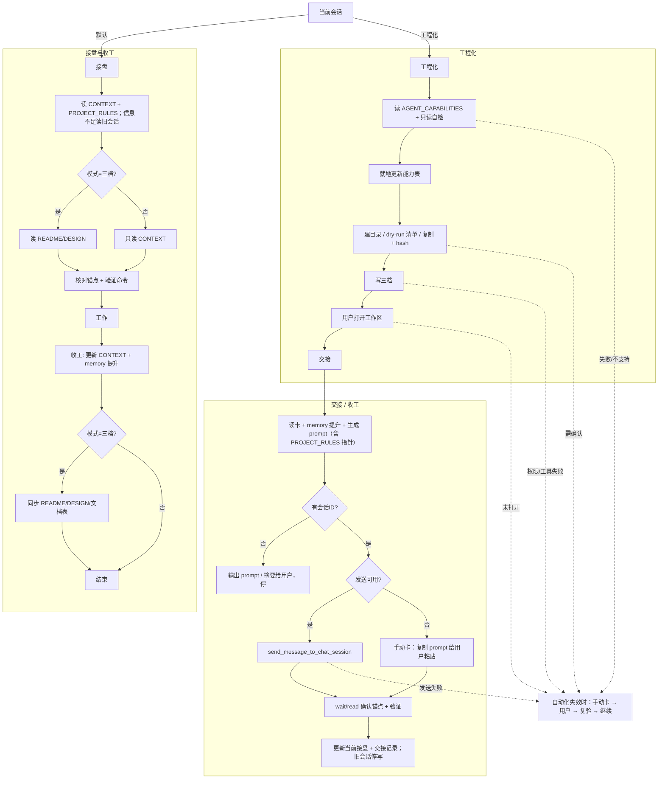

# multi-agent-task-handoff · 方案设计

> 面向改这套协议的人：为什么只留一份交接卡、工程化与交接怎么接、哪些步骤只能手动。使用者说明见 [README.md](README.md)，当前进度见 [CONTEXT.md](CONTEXT.md)。
> 最近更新：2026-10-28

## 问题与目标

会话是易失的：换会话、换 agent、换时间段，接盘的人只能从目录和上一段会话猜。靠人记会漏，靠常驻强制会拖慢每轮，靠文档自身又会写成日志；所以需要一个目录内的、任何 agent 都能读的最小协议。

目标：默认一份目录内的 `CONTEXT.md` 交接卡，任何 agent 都能读；需要时用 `工程化` 升到三档；交接只发状态，不复制聊天历史；能自动的自动做，做不到的明确列给用户。

非目标：自动记忆、会话回放、AI 摘要、向量检索、强制合规。

## 设计思路

| 决策 | 理由 | 代价 |
|---|---|---|
| 默认只强制一份 `CONTEXT.md` | 交接只需要“到哪了、下一步、坑”；三档必填会把合规件铺到每个子目录 | 人类读者的说明/设计文档不再自动存在，需要时得另写 |
| `工程化` 才升三档 | 只有明确要“建目录 + 迁移 + 给人看”时才值得维护 README/DESIGN | 多一个显式命令；用户要记得用 |
| 工程化先做只读自检 | 多 agent 宿主能力不同；先把“能做/需确认/需手动”摊开，避免假装成功 | 多一次探针和四行输出 |
| 交接只发状态，不复制历史 | 跨 agent 会话格式不通用；压缩后的卡更便宜，也更适合蹭额度 | 依赖旧会话把关键决策写进卡；漏写就丢 |
| 旧 ID 只作参考 | 新会话可按需 `read_chat_session` 查细节 | 跨宿主没有这个工具时，卡必须自包含 |
| 交接卡放任务目录 | 文件跟着目录走；宿主数据库/插件不随目录走 | 没有自动召回；找旧事靠 `git log`/`rg`/归档 |
| git 可选 | 很多目录不是 git；git 只是部分项目为推 GitHub 才用 | 非 git 目录靠 `压卡备份.md` 里的原件追溯 |
| 只记关键动作 | 格式调整、错字提交对下一个 agent 没有意义；完整历史会淹没当前状态 | 查细节要去 `git show` 或旧会话 |
| 不安装、不挂钩子、不写全局规则 | 每轮变慢的主因是常驻面 | 没有自动执行；agent 不读卡就不会生效 |
| 入口靠命令与交接 prompt，不铺任务级 `AGENTS.md` | 每个任务少一份副本；交接 prompt 自带读卡顺序；人工续接用 `接盘` | 新会话只输入「继续」不再保证自动读卡；靠显式调用兜底 |
| 能力表用矩阵缓存 | 避免每个 agent/每次会话重复探测；一行一个版本、固定能力列，增长有界 | 过期风险；关键项仍要复验 |
| 打开工作区留给用户 | 当前没有 create/open workspace 工具或 CLI | 流程多一个手动停顿 |
| README/DESIGN 按需写 | 只有外部读者/设计决策才需要；小任务写三档是纯开销 | 项目变大时要主动补文档 |

## 架构与关键接缝

目标布局：

```text
multi-agent-task-handoff/
├─ SKILL.md                 # 默认单档 + 工程化/压卡/交接 + 自检
├─ README.md                # 使用说明
├─ DESIGN.md                # 本文件
├─ CONTEXT.md               # 本目录的示例交接卡
└─ assets/
   ├─ CONTEXT.md.tpl        # 默认模板
   ├─ README.md.tpl         # 工程化可选
   ├─ DESIGN.md.tpl         # 工程化可选
   └─ AGENT_CAPABILITIES.md.tpl  # 能力矩阵模板
```

流程：



关键接缝：

1. **自检 ↔ 执行**：探针只读；输出了“可自动”的步骤才执行，输出“需确认”的先给清单。
2. **工程化 ↔ 交接**：工程化只准备目录和文档；交接只发状态。两者可以分开跑，中间允许用户手动打开工作区。
3. **卡 ↔ 交接 prompt**：prompt 从卡生成，不复制聊天历史；旧 ID 只让新会话按需查细节。
4. **状态锚点 ↔ git/备份**：git 仓库写 HEAD + 分支 + 工作树状态；非 git 写时间戳（原件在 `压卡备份.md`）。锚点对不上就停。
5. **能力表 ↔ 自检**：先读 `AGENT_CAPABILITIES.md`，按表复验关键项；结果变化就地更新，不按探测追加行。
6. **memory ↔ 交接**：收工/交接前只把会影响下一家的坑提升到 CONTEXT/DESIGN；宿主 memory 不做每轮 diff。

## 已定语义与边界

| 主题 | 约定 |
|---|---|
| 交接卡字段 | 目标/完成定义、现在在哪、下一步、坑、状态锚点、验证命令、交接记录（≤10）、参考 ID；≤100 行 |
| 关键动作 | 判定：不知道它，下一家会做错或重做才写；能从 CONTEXT/README/DESIGN/git 直接得到的不写。类别：决策与口径、状态变化、阻塞与解除、不可逆操作、验证结论、下一步依赖；日常提交、格式调整、文件清单不算 |
| 记录粒度 | 每次收工只加 1 条关键动作；交接记录 ≤10 条；超出删最旧前，先把仍有效内容提升到当前状态/下一步/坑；不写变更流水；压卡仅兜底 |
| 状态锚点 | git `HEAD` + 分支 + 工作树是否干净；非 git 为时间戳/`压卡备份.md`；只用于核对漂移 |
| 完成定义 | 每阶段一条可验证标准；接盘先跑验证命令 |
| 一个写者 | 同一时间只有一个会话改 `CONTEXT.md`；交接后旧会话停写 |
| 不复制历史 | 新会话无历史；旧 ID 按需读，不搬运 transcript |
| 跨 agent | 文件协议通用；Qoder 的会话/工作区 API 在 Codex/Claude 上不存在，按宿主能力降级 |
| 宿主 memory | 辅助回忆，不是交接契约；下一家需要的事实进 CONTEXT/DESIGN；不做每轮 diff |
| 项目规则 | `PROJECT_RULES.md`（`D:\agent_workspace`）；跨项目/跨 agent 的产物、验证、交接约定；宿主专属规则留在各自全局文件；能力表是 agent 侧缓存 |
| memory 提升 | 与模式无关；单档写进 CONTEXT，三档再同步 README/DESIGN；只在收工/交接做 |
| DESIGN 替代 | 根目录已有承担方案设计的交付文档（`架构设计.md`、`XX实施方案.md` 这类复合名；评审意见不算）时，不另立 DESIGN，交接以该文档为准 |
| 入口 | `接盘` 命令或 `交接` prompt（自带读卡顺序）；不铺任务级 `AGENTS.md`，不写全局规则；宿主不读文件时显式调用 |
| 能力表 | `D:\agent_workspace\AGENT_CAPABILITIES.md`（agent 工作区根）；一行一个 agent/版本，固定能力列，就地更新；30 天/版本变化复验；缓存不是契约 |
| 自动化失效 | 先只读探测；四类；只能手动给手动卡（已完成/卡点/步骤/验证/回我）；用户完成后复验 |
| 可逆整理 | 搬移/拆分/重排/备份可自动并校验（行数、hash、链接）；内容取舍先按证据判，证据不足或不可逆才确认；默认只搬不删 |
| 决策默认 | 协议、文档、锚点、能力表能支撑的自己决定并记依据；只在规则冲突、缺事实、不可逆时上升给用户 |
| 评估指标 | ①开场读取量（省 token）②自动化覆盖率；冲突时先省读取量，不新增必读文件 |
| 参数默认 | `<任务名>` 可省略，默认 cwd 目录名；cwd 不是任务目录时显示 `--help`，不猜 |

> 边界与代价已在「设计思路」表里逐条写明；这里只定义语义，避免重复。宿主 memory 的边界参考 [Codex memories 文档](https://learn.chatgpt.com/docs/customization/memories?surface=app)。

## 版本与设计演进

旧版代码已从工作树删除，tag 也已删除；这里只留设计演进。git 历史未改写。

v1→v2 的转折点不是“不要交接”，而是“不要用常驻强制层保证交接”：v1 的闸门/安装器/看门狗保证了文档存在，代价是每轮变慢、文档长成日志；v2 保留交接目标，删掉强制层，默认一份卡，三档改为显式工程化。

| 版本 | 时间 | 形态 | 理念更替 | 具体措施 |
|---|---|---|---|---|
| v1.0 | 2026-10-08 | 两档 + init/check | 会话易失，先把交接文档落成骨架 | 两档模板；`init-task.sh` 铺骨架；`check-docs.sh` 验收 |
| v1.1 | 2026-10-14 | 三档 + 闸门加严 | 使用说明与设计取舍分开，避免手册被取舍表淹没 | 拆出 `DESIGN.md`；加严 `[题]/[空]/[链]`；补中文命名与链接规则 |
| v1.2 | 2026-10-15–16 | 入口模式 + 自动铺满 + 看门狗 | 多 agent/多机分发，靠机械兜底防止副本漂移 | 双锚、出处戳、`-Prune`、`pre-push`、每日看门狗、夹具/变异测试 |
| v1 卸载 | 2026-10-16 | 全部撤掉 | 强制层成本高于收益：常驻规则/钩子/定时任务拖慢每轮；文档长成 46–157KB 日志 | 删三处副本、全局规则、钩子、计划任务与 Codex 自动化；停止维护 |
| v2 | 2026-10-23 | 默认单档 + 可选工程化/交接 | 从“强制规范”转向“最小协议”：交接目标不变，删掉强制层；任何 agent 读文件即可；跨 agent、非 git、蹭额度；只记关键动作 | 一任务一卡；`工程化` 才升三档；`交接` 只发状态；无安装/钩子；git 可选 |
