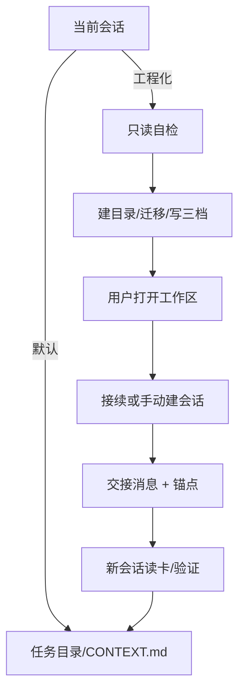

# multi-agent-task-handoff · 方案设计

> 面向改这套协议的人：为什么只留一份交接卡、工程化与交接怎么接、哪些步骤只能手动。使用者说明见 [README.md](README.md)，当前进度见 [CONTEXT.md](CONTEXT.md)。
> 最近更新：2026-10-28

## 问题与目标

会话是易失的：换会话、换 agent、换时间段，接手的人只能从目录和上一段会话猜。靠人记会漏，靠常驻强制会拖慢每轮，靠文档自身又会写成日志；所以需要一个目录内的、任何 agent 都能读的最小协议。

目标：默认一份目录内的 `CONTEXT.md` 交接卡，任何 agent 都能读；需要时用 `工程化` 升到三档；交接只发状态，不复制聊天历史；能自动的自动做，做不到的明确列给用户。

非目标：自动记忆、会话回放、AI 摘要、向量检索、强制合规。

## 设计思路

| 决策 | 理由 | 代价 |
|---|---|---|
| 默认只强制一份 `CONTEXT.md` | 交接只需要“到哪了、下一步、坑”；三档必填会把合规件铺到每个子目录 | 人类读者的说明/设计文档不再自动存在，需要时得另写 |
| `工程化` 才升三档 | 只有明确要“建目录 + 迁移 + 给人看”时才值得维护 README/DESIGN | 多一个显式命令；用户要记得用 |
| 工程化先做只读自检 | 多 agent 宿主能力不同；先把“能做/需确认/需手动”摊开，避免假装成功 | 多一次探针和四行输出 |
| 交接只发状态，不复制历史 | 跨 agent 会话格式不通用；压缩后的卡更便宜，也更适合蹭额度 | 依赖旧会话把关键决策写进卡；漏写就丢 |
| 旧会话 ID 只作参考 | 新会话可按需 `read_chat_session` 查细节 | 跨宿主没有这个工具时，卡必须自包含 |
| 交接卡放任务目录 | 文件跟着目录走；宿主数据库/插件不随目录走 | 没有自动召回；找旧事靠 `git log`/`rg`/归档 |
| git 可选 | 很多目录不是 git；git 只是部分项目为推 GitHub 才用 | 非 git 目录要自己留备份锚点 |
| 只记关键动作 | 格式调整、错字提交对下一个 agent 没有意义；完整历史会淹没当前状态 | 查细节要去 `git show` 或旧会话 |
| 不安装、不挂钩子、不写全局规则 | 每轮变慢的主因是常驻面 | 没有自动执行；agent 不读卡就不会生效 |
| 触发器用任务级 `AGENTS.md` 的 3 行 | 宿主支持工作区根文件；全局规则会影响所有项目；3 行足够让 agent 读卡 | 任务目录多一份小文件；宿主不读时仍需显式调用 |
| 能力表用矩阵缓存 | 避免每个 agent/每次会话重复探测；一行一个版本、固定能力列，增长有界 | 过期风险；关键项仍要复验 |
| 打开工作区留给用户 | 当前没有 create/open workspace 工具或 CLI | 流程多一个手动停顿 |
| README/DESIGN 按需写 | 只有外部读者/设计决策才需要；小任务写三档是纯开销 | 项目变大时要主动补文档 |

## 架构与关键接缝

目标布局：

```text
multi-agent-task-handoff/
├─ SKILL.md                 # 默认单档 + 工程化/交接/接续 + 自检
├─ README.md                # 使用说明
├─ DESIGN.md                # 本文件
├─ CONTEXT.md               # 本目录的示例交接卡
└─ assets/
   ├─ CONTEXT.md.tpl        # 默认模板
   ├─ README.md.tpl         # 工程化可选
   ├─ DESIGN.md.tpl         # 工程化可选
   ├─ AGENTS.md.snippet     # 任务级触发片段
   └─ AGENT_CAPABILITIES.md.tpl  # 能力矩阵模板
```

流程：



关键接缝：

1. **自检 ↔ 执行**：探针只读；输出了“可自动”的步骤才执行，输出“需确认”的先给清单。
2. **工程化 ↔ 交接**：工程化只准备目录和文档；交接只发状态。两者可以分开跑，中间允许用户手动打开工作区。
3. **卡 ↔ 交接 prompt**：prompt 从卡生成，不复制聊天历史；旧 sessionId 只让新会话按需查细节。
4. **状态锚点 ↔ git/备份**：git 仓库写 HEAD + 分支 + 工作树状态；非 git 写备份路径/时间戳。锚点对不上就停。
5. **README/DESIGN ↔ 工程化**：只有 `工程化` 才生成三档；默认单档不读这两个模板。

自检的四类结论：

- ✅ 可自动：建目录、复制、写文档、发消息给已知 sessionId、等/读。
- 🟡 需确认：移动/删除源、覆盖、commit/push、创建会话。
- 🔴 需手动：打开工作区；跨宿主会话 API。
- ⛔ 不支持：复制完整会话历史、搬宿主内部附件/缓存。

## 已定语义与边界

- **交接卡字段**：目标/完成定义、现在在哪、下一步、坑、状态锚点、验证命令、交接记录（≤5 条）、参考会话 ID。上限 100 行。
- **关键动作**：决策、状态变化、阻塞、下一步、验证结果；日常提交、格式调整、文件清单不算。
- **状态锚点**：git `HEAD` + 分支 + 工作树是否干净；非 git 为备份路径/时间戳。它是核对漂移的凭据，不是历史。
- **完成定义**：每个阶段写一条可验证的标准；接手的人先跑验证命令。
- **一个写者**：同一时间只有一个会话改 `CONTEXT.md`；交接后旧会话停写。
- **git 只做回滚**：不用 commit 历史当交接；细节用 `git show` 查。
- **不安装**：没有全局规则、钩子、定时任务、副本、守护进程、向量库、AI 调用。
- **不复制历史**：新会话无历史；需要细节按旧 sessionId 查，不搬运 transcript。
- **工作区打开是手动步骤**：没有 create/open workspace 工具或 CLI，skill 只输出路径和下一步。
- **跨 agent**：文件协议通用；Qoder 的会话/工作区 API 在 Codex/Claude 上不存在，按宿主能力降级。
- **宿主 memory 是辅助回忆，不是交接契约**：下一家需要的事实进 CONTEXT/DESIGN；Codex 官方文档同样建议必须遵守的指导写进 AGENTS.md / 已签入文档（见 [Codex memories 文档](https://learn.chatgpt.com/docs/customization/memories?surface=app)）。
- **memory 提升与模式无关**：单档写进 CONTEXT；三档再同步 README/DESIGN；`工程化` 只决定文档集，不决定是否提升。
- **触发器**：任务级 `AGENTS.md` 的 3 行片段（`assets/AGENTS.md.snippet`）；不写全局规则；宿主不读时回退 `/multi-agent-task-handoff`。2026-10-28 uno-webgame 试点：新会话只输入“继续”即读 `AGENTS.md` + `CONTEXT.md`。
- **能力表**：`AGENT_CAPABILITIES.md` 记录每个 host/版本的自动化边界；一行一个 agent/版本，就地更新，不按 workspace/能力追加；30 天或版本变化后复验；只是缓存，不是契约。

## 版本与设计演进

旧版代码已从工作树删除，tag 也已删除；这里只留设计演进。git 历史未改写。

v1→v2 的转折点不是“不要交接”，而是“不要用常驻强制层保证交接”：v1 的闸门/安装器/看门狗保证了文档存在，代价是每轮变慢、文档长成日志；v2 保留交接目标，删掉强制层，默认一份卡，三档改为显式工程化。

| 版本 | 时间 | 形态 | 理念更替 | 具体措施 |
|---|---|---|---|---|
| v1.0 | 2026-10-08 | 两档 + init/check | 会话易失，先把交接文档落成骨架 | 两档模板；`init-task.sh` 铺骨架；`check-docs.sh` 验收 |
| v1.1 | 2026-10-14 | 三档 + 闸门加严 | 使用说明与设计取舍分开，避免手册被取舍表淹没 | 拆出 `DESIGN.md`；加严 `[题]/[空]/[链]`；补中文命名与链接规则 |
| v1.2 | 2026-10-15–16 | 入口模式 + 自动铺满 + 看门狗 | 多 agent/多机分发，靠机械兜底防止副本漂移 | 双锚、出处戳、`-Prune`、`pre-push`、每日看门狗、夹具/变异测试 |
| v1 卸载 | 2026-10-16 | 全部撤掉 | 强制层成本高于收益：常驻规则/钩子/定时任务拖慢每轮；文档长成 46–157KB 日志 | 删三处副本、全局规则、钩子、计划任务与 Codex 自动化；停止维护 |
| v2 | 2026-10-23 | 默认单档 + 可选工程化/交接 | 从“强制规范”转向“最小协议”：交接目标不变，删掉强制层；任何 agent 读文件即可；跨 agent、非 git、蹭额度；只记关键动作 | 一任务一卡；`工程化` 才升三档；`交接` 只发状态；无安装/钩子；git 可选 |
