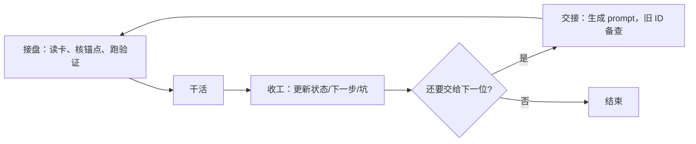

# multi-agent-task-handoff · 多 agent 任务交接

> 一份 `CONTEXT.md` 交接卡，让下一个会话或另一个 agent 接着干；需要时用 `工程化` 升三档，`交接` 只发状态、不复制聊天历史。
> 标识 `multi-agent-task-handoff`；本目录是协议真源。MIT 许可。
> 设计取舍见 [DESIGN.md](DESIGN.md)，当前进度见 [CONTEXT.md](CONTEXT.md)。
> 最近更新：2026-10-29

## 文档

| # | 文档 | 读者 | 内容 |
|---|---|---|---|
| 1 | [README.md](README.md) | 使用者 | 本文：安装、命令、限制 |
| 2 | [SKILL.md](SKILL.md) | agent | 协议正文：接盘、交接、压卡、工程化、自检 |
| 3 | [DESIGN.md](DESIGN.md) | 评审 / 二次开发 | 取舍、流程、语义 |
| 4 | [CONTEXT.md](CONTEXT.md) | 接盘 agent | 本仓库的示例交接卡 |
| 5 | [assets/CONTEXT.md.tpl](assets/CONTEXT.md.tpl) | 使用者 | 单档模板 |
| 6 | [assets/README.md.tpl](assets/README.md.tpl) | 使用者 | 三档 README 模板 |
| 7 | [assets/DESIGN.md.tpl](assets/DESIGN.md.tpl) | 使用者 | 三档 DESIGN 模板 |
| 8 | [assets/AGENT_CAPABILITIES.md.tpl](assets/AGENT_CAPABILITIES.md.tpl) | 使用者 | 能力矩阵模板 |
| 9 | [install.sh](install.sh) · [安装.bat](安装.bat) | 使用者 | 安装到当前宿主 |
| 10 | [压卡备份.md](压卡备份.md) | 追溯 | 本仓库的状态历史 |

## 一句话说明

**skill 是可选的**：状态永远在任务目录的 `CONTEXT.md`。不装就手动复制模板，并给新 agent 一段自包含指令（不能只说“读卡”）；装了可调用 `/multi-agent-task-handoff`，由它定义读卡、工程化、交接。装 skill 不等于全自动，仍需一次触发。默认单档；`工程化` 才创建 README/DESIGN 并迁移文件；`交接` 只发交接消息，不复制聊天历史。

## 快速开始

手动（任何 agent）：

```bash
cp assets/CONTEXT.md.tpl <任务目录>/CONTEXT.md
```

Qoder：

```text
/multi-agent-task-handoff                  # 默认单档：确保/刷新当前目录的 CONTEXT.md
/multi-agent-task-handoff 接盘              # 当前会话进入工作状态
/multi-agent-task-handoff 工程化            # 当前目录工程化（要建新目录时带名字）
/multi-agent-task-handoff 压卡              # 检查并精简当前目录的 CONTEXT
/multi-agent-task-handoff 收工              # 只整理写卡，不发送
/multi-agent-task-handoff 交接 <ID>         # 整理后发给指定会话
```

OpenCode / OpenChamber 里可直接说「接盘 / 接手 / 交接 / 收工 / 压卡」触发；OpenCode 也可用 `@multi-agent-task-handoff`，OpenChamber 用 `$multi-agent-task-handoff <参数>` 显式调用。其他宿主把 `SKILL.md` 放到自己的 skill 目录，或直接把这段指令交给 agent。

所有命令只看当前目录，目录名就是任务名；要处理别的任务先 `cd`。唯一参数是 `交接` 的 ID。别名：接手=接盘，收工=交接（无 ID），压缩上下文=压卡，工程/建档=工程化。命令可用 `+` 或空格串行组合，如 `压卡+收工`、`工程化 交接 <ID>`；从左到右，前一步失败就停。

## 流程



## 工作区根

`PROJECT_RULES.md`（项目规则）、`AGENT_CAPABILITIES.md`（能力表）和 `工程化` 新建目录都在工作区根下：

- 优先读环境变量 `AGENT_WORKSPACE`
- 未设置时用 `D:\agent_workspace`（作者本机默认；其他机器建议显式设置）
- 目录不存在时，只读项跳过；`工程化` 建目录前会先问你

Windows 永久设置（新开终端生效）：

```bat
setx AGENT_WORKSPACE D:\agent_workspace
```

临时设置（当前会话）：

```bash
export AGENT_WORKSPACE=/path/to/workspace
```

## 使用说明

### 默认单档

- 开始：读 `CONTEXT.md`，核对状态锚点，跑验证命令。
- 收工：只更新「现在在哪 / 下一步 / 坑」，交接记录加 1 条关键动作；≤10 条，超出时先把仍有效内容提升到状态/坑，再删最旧；不写变更流水。卡超 100 行才用 `压卡` 兜底。
- 关键判定：不知道这条，下一家会不会做错或重做？会才写；能从现有文档或 git 得到的不写。
- 收工/交接时把宿主 memory 里会影响下一家的坑写进「坑与约束」；不需要工程化。
- 入口：`接盘` 命令，或前一家的 `交接` prompt（自带读卡顺序）。不在任务目录铺 `AGENTS.md`，少一份要维护的副本。
- `README.md` / `DESIGN.md` 只在有外部读者或设计取舍时写，不是必填。
- 根目录已有承担方案设计的交付文档（如 `架构设计.md`、`XX实施方案.md`）时，用它代替 `DESIGN.md`；同一件事只留一份真源。

### 工程化

只在明确要求时执行：

1. 只读自检：写权限、git 状态与远端、工作区、发送/等待/读回手段、宿主 memory、CLI；先读工作区根的 `AGENT_CAPABILITIES.md` 并复验关键项。
2. 输出四行：可自动 / 需确认 / 需手动 / 不支持；能做的直接做，做不到的列给用户。
3. 建目录；从当前 cwd 迁移顶层非隐藏文件（排除 `.git`、`node_modules`、应用缓存）；先出清单，确认后复制、校验、默认不删源。
4. 用 `assets/*.tpl` 写三档：头块 + `## 文档` 表；README 按 GitHub 落地页，DESIGN 含拓扑/流程/架构树，CONTEXT 写 `模式：三档` 且 ≤100 行；已有方案设计交付文档时用其代替 DESIGN。
5. 打开目录为工作区只能手动；之后 `交接` 准备交接信息。

### 压卡

`CONTEXT.md` 超过 100 行或历史堆成日志时，把历史搬出去：

- 日志节原样搬到同目录 `压卡备份.md`，逐块逐字校验，不改写内容。
- 有 git 直接提交；非 git 不另建备份，把原 CONTEXT 原样附到 `压卡备份.md` 末尾。
- 只搬不删；确需删除时单独确认。

### 交接 / 收工

- 不带 ID（收工）：整理任务信息、按可用 memory 来源提升、更新 CONTEXT；探测到投递手段就送达，没有才把 prompt 给用户。
- 带 ID（交接）：在收工基础上发给该会话；目标必须已注册、未归档，`send_message_to_chat_session` 成功只代表接收。
- 投递和确认都按能力表；没有 wait/read 就用新会话首条回复或下次接盘核对，不伪造发送或回执。
- prompt 由交接卡生成，包含路径、锚点、验证命令、下一步、勿动文件、已决策、项目规则指针、旧 ID。
- 不复制历史；细节按旧 ID 按需读取。

### 跨 agent

同 agent 不同会话：Qoder 用 `send_message_to_chat_session`。跨 agent（Codex/Claude 等）：先探测宿主有没有等价投递手段（CLI 会话恢复/执行、MCP、可写队列文件等），有就自动送达并验证；没有才 `收工` 生成 prompt 让用户粘贴。文件协议通用。

## 安装与同步

Qoder 的技能目录是**实拷贝**，目录 junction 不被扫描。`install.sh` 按环境变量识别**当前打开这个工作区的 agent**，只给它自己的 skill 目录安装，不替别的宿主铺副本；也可以用 `--host` 显式指定：

| 宿主 | 识别依据 | 安装目录 |
|---|---|---|
| Qoder | `QODER_CONFIG_DIR` / `QODERCN_CONFIG_DIR` | `<配置目录>/skills/multi-agent-task-handoff` |
| Claude Code | `CLAUDECODE` / `CLAUDE_CONFIG_DIR` | 同上（默认 `~/.claude`） |
| Codex | `CODEX_HOME` | 同上（未设置时用 `--host codex`） |
| OpenCode | `OPENCODE` / `OPENCODE_CONFIG_DIR` | 同上（默认 `~/.config/opencode`） |
| ZCode | `ZCODE_CONFIG_DIR` / `ZCODE_APP_VERSION` | 同上（默认 `~/.zcode`） |

```bash
bash install.sh --dry-run   # 只打印宿主、目标、动作
bash install.sh             # 装到当前宿主
```

Windows 双击 `安装.bat`；识别不出宿主时会问一次 qoder / claude / codex / opencode / zcode。选项：`--host`、`--target DIR`、`--force`（覆盖非托管非空目录）、`--no-hook`、`--no-register`、`--dry-run`。换宿主时，在新宿主里重跑一次。

安装会写 `.skill-version`（commit + 时间），并默认把目标追加到 `.skill-sync-paths`、启用仓库本地 `core.hooksPath=.githooks`。之后每次提交由 `post-commit` 把 HEAD 刷到清单里的目录；父目录不存在就跳过。钩子只在 commit 时跑，不常驻；没启用时重跑 `install.sh`。

`.skill-sync-paths` 是**本地文件**（已 gitignore），记录本机安装目录，不随仓库分发；换机器跑一次 `install.sh` 即生成。

卸载：删掉安装目录，并从 `.skill-sync-paths` 删掉对应行。

### 自检 / 更新

`/multi-agent-task-handoff 自检`（别名 `更新`）比对安装目录 `.skill-version` 与源仓库 HEAD：

- 一致：报已是最新；离线时注明未核对 GitHub。
- 落后且能快进：拉取后跑 `bash install.sh`（当前宿主），或同步 `.skill-sync-paths` 里的目录。
- 有本地改动、分叉或离线拉不动：停，列手动步骤，不覆盖。

## 限制与注意事项

- 不自动捕获、不在任务目录装钩子、不写全局规则、不起后台服务、不调用模型。
- 打开目录为工作区只能手动：当前没有 create/open workspace 工具或 CLI。
- 不复制完整会话历史；交接卡 + 旧 ID 按需查。
- 一个目录同一时间一个写者。
- 三档只在任务目录根；没有用户明确要求，不往更深的子目录铺 CONTEXT/DESIGN。
- agent 能按协议和现有文档判断的，自己决定并记录依据；只在规则冲突、信息缺失或不可逆时找你确认。
- git 不是前提；非 git 目录把压卡前原文附在 `压卡备份.md` 末尾，不另建备份目录。
- 卡超过 100 行说明它在写日志，不是交接。
- 敏感内容留在本机。

## 作者实机调研（仅供参考）

[作者实机调研/](作者实机调研/) 下是作者本机的三份工作区文档快照：`AGENTS.md`、`PROJECT_RULES.md`、`AGENT_CAPABILITIES.md`。路径、账号、宿主版本都是作者环境，不是通用约定；能力表的通用模板见 [assets/AGENT_CAPABILITIES.md.tpl](assets/AGENT_CAPABILITIES.md.tpl)。

## 许可

[MIT](LICENSE) © 2026 Lizardon386
