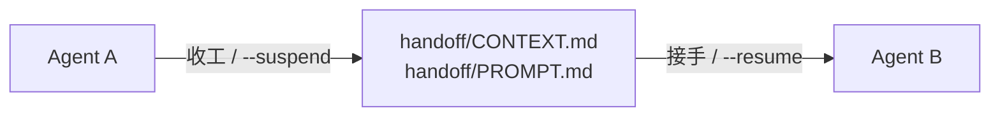

# multi-agent-task-handoff（任务交接）· 使用说明

> 换 agent、换宿主、隔天回来，任务还能接着干：把状态写进项目目录的 `handoff/`，下一个 agent 读卡即可接手。
> 一个 skill、一个目录、一份交接卡；不装常驻服务，不绑定宿主，不复制聊天历史。
> 本文件是项目根 `README.md`；GitHub 首页直接显示它，不生成副本。
> 最近更新：2026-11-12

[这是什么](#这是什么) · [安装](#安装) · [最短路径](#最短路径3-步) · [使用说明](#使用说明) · [产物](#产物与目录) · [限制](#限制与注意事项) · [常见问题](#常见问题)

## 文档
> 只列项目文档与阅读对象；跨目录用相对路径；不复制正文。

| 文档 | 阅读对象 | 内容 |
|---|---|---|
| [README.md](README.md) | 使用者 | 这是什么、怎么跑、限制（本文） |
| [docs/DESIGN.md](docs/DESIGN.md) | 评审 / 开发 | 摘要、方案、备选、风险、决策 |
| [docs/COMMANDS.md](docs/COMMANDS.md) | 使用者 | 命令参考：语法、默认值、副作用、错误（可选） |
| [handoff/CONTEXT.md](handoff/CONTEXT.md) | 接手 agent | 完整文档表、当前状态、下一步、记忆提炼、坑 |

完整文档表（含 PROMPT、SKILL、HELP、压卡备份）见 [handoff/CONTEXT.md](handoff/CONTEXT.md)。

## 这是什么
> 只写痛点、适用与不适用；不写命令细节。

agent 的上下文是易失的。换一个 agent、换一个宿主、隔一天回来，上一个 agent 想过什么、试过什么、卡在哪，全都没了。通常只能翻聊天记录，或者靠人复述。

这个 skill 只做一件事：**把“现在到哪了”写成一份任何 agent 都能读的文件**，放在项目目录的 `handoff/` 里。下一位进来，读它，就能接着干。

适合：

- 一个任务会跨越多个 agent 实例，或者要在不同宿主之间转手；
- 需要留下“为什么这么定、下一步做什么、哪些别动”；
- 想让交接这件事可检查、可迁移，而不是靠记忆。

不适合：

- 纯问答、一次性脚本；
- 已经有完善工单/项目管理流程，且不需要 agent 读上下文的场景。

agent 之间的闭环只有一步：



## 安装
> 只写安装；人装与由 agent 装分开；多宿主用 `--host`，副本用 `--syncall`。

### 平台入口

| 平台 | 入口 | 说明 |
|---|---|---|
| Windows | 双击 `安装.bat` | 自动找 git/bash 并调用 `install.sh`；识别不出宿主时提示选择 |
| Windows（终端） | `bash install.sh` | 在 Git Bash 里执行；诊断/同步用 `scripts\运行时.bat` |
| macOS / Linux | `bash install.sh` | 需要 bash；git 可选 |

先跑 `bash install.sh --dryrun` 可确认安装目标，不写文件。

### 手动安装

```bash
git clone https://github.com/Lizardon386/multi-agent-task-handoff.git
cd multi-agent-task-handoff
bash install.sh --dryrun     # 确认安装目标
bash install.sh               # 只装当前宿主
```

需要安装到多个宿主时，对每个宿主各执行一次 `--host` 安装；从源仓库收工时 `--suspend` 会跑 `scripts/handoff.sh --syncall` 对齐各副本（安装副本没有 HEAD，跳过），幂等，可随时手动重跑。

### 由 agent 安装

把仓库地址交给 agent，由它执行安装：

```text
克隆 https://github.com/Lizardon386/multi-agent-task-handoff，
先跑 install.sh --dryrun 确认安装目标，再跑 install.sh 只装当前宿主；识别不出宿主就用 --host 指定。
```

agent 会把 skill 安装到当前宿主的 `skills/multi-agent-task-handoff`，把目标登记到 `$AGENT_CONFIG/sync-paths`；首次安装还会创建 `config.toml` 和能力表模板。

### 最短路径（3 步）

1. **装**：按上表任选一种方式安装。
2. **建档**：在项目里说「建档」或跑 `/multi-agent-task-handoff --doc --init`，生成 `handoff/CONTEXT.md`。
3. **交接**：收工说「收工」；下次（或换 agent）说「接手」。

之后不用记命令，自然语言即可；`--check` 用于体检，`--printpath` 用于排查路径。

## 使用说明
> 只写触发方式与常用场景；命令语义见 SKILL / HELP。

### 触发方式

- 支持斜杠命令：`/multi-agent-task-handoff <参数>`
- 支持 skill 工具：直接说「接手 / 收工 / 修复」，或从 skill 列表里选
- 都不支持：把 `SKILL.md` 的路径交给 agent，让它按文件协议执行

参数可省略（默认 `--resume`）；完整列表见 `--help`。

### 常用场景

| 场景 | 说法 / 命令 | 会发生什么 |
|---|---|---|
| 新任务开工 | `--doc [--guard \| --init] [--target DIR]` | 默认挡位 `[defaults].doc=guard`；`--guard` 维护已有文档（删文档表失效协议行，其余只报告/建议），`--init` 只新增缺失 CONTEXT（README 仅 GitHub/确认，DESIGN 需取舍确认，COMMANDS 仅用户要求，不还原）；布局/标记/迁移链接由 `--doc` 处理 |
| 接手别人的任务 | `接手` / `--resume` | 读 PROMPT → CONTEXT，核锚点；必跑 `git status`，其余验证按需 |
| 本轮收工 | `收工` / `--suspend` | 按需压卡、写 CONTEXT、覆盖 PROMPT、对齐安装副本（仅源仓库）；`--push` 在项目目录推送当前仓库（源仓库环境推源仓库），网络错误重试 3 次，Windows 再走 TLS 回退 |
| 热交接给另一个会话 | `--post "<内容>" [--new \| --next <ID \| 会话名>]` | 只投消息，不写卡、不动 git；默认目标读 `[defaults].post` |
| 体检/修复 | `--check` / `--fix` | 按 `assets/CHECK.md` 的 C01–C13 逐项检查（只读）；`--fix` 只修可修项，文档整理交给 `--doc` |
| 摸底宿主能力 | `--probe` | 按 `assets/PROBE.md` 固定清单实测并更新能力表；`--live` 先出计划、确认一次，跑完 L1（通道）+ L2（真接盘），临时项目/会话测后清理 |
| 路径诊断 | `--printpath` | 表格输出配置目录、工作区根、能力表（含日期）、源仓库、宿主识别来源、当前安装副本与全部副本的路径和 commit；`--host` / `--target` 可显式指定 |
| 改默认挡位 | `--gear <key>=<值>` / `--gear list` | 写入 `config.toml` 的 `[defaults]`；用 `--gear list` 查看键与允许值，非法值不改文件 |

项目第一次用先跑 `--doc --init` 建档（没有 `handoff/` 不会自动创建）；之后 `--doc` 只整理布局，接手 / `--resume` 继续，收工 / `--suspend` 写卡并生成 `PROMPT.md`。

一次只用一个命令。`--suspend` / `--probe` / `--post` / `--doc` 的默认值读 `$AGENT_CONFIG/config.toml` 的 `[defaults]`；`--gear` 可读写 `[defaults]` 挡位（键名与 `[defaults]` 一致，`--gear list` 查看），非法值不修改；显式参数覆盖。安装、配置、旧布局迁移的细节见 [docs/DESIGN.md](docs/DESIGN.md) 和 [SKILL.md](SKILL.md)。

## 产物与目录
> 只列产物位置与用途；项目自有文档不动。

```text
<项目目录>/
├─ README.md          # 项目说明（本文）；scope=root
├─ docs/              # 设计/方案/指导类；scope=docs
│  └─ DESIGN.md       # 设计取舍（需要时）
├─ plan/              # 计划产出；scope=plan（宿主 plan mode / agent 手写）
└─ handoff/           # 交接文档；scope=handoff
   ├─ CONTEXT.md      # 交接卡：状态、下一步、记忆提炼、坑、记录
   ├─ PROMPT.md       # 交接指针，自动生成，默认 gitignore
   └─ COMPACT_BACKUP.md  # 压卡搬出的历史
```

交接卡长这样（节选）：

```markdown
## 现在在哪
- 已完成：登录接口与单测
- 进行中：刷新 token 的并发处理
- 在飞文件：src/auth/refresh.ts

## 下一步
1. 补 refresh 并发测试
2. 跑 `npm test` 后提交
```

| 产物 | 位置 | 用途 |
|---|---|---|
| 交接卡 | `handoff/CONTEXT.md` | 下一位 agent 的入口 |
| 交接指针 | `handoff/PROMPT.md` | 发送给接手 agent 的短消息源 |
| 历史归档 | `handoff/COMPACT_BACKUP.md` | 卡超限时把日志搬出 |
| 计划产出 | `plan/` | 宿主计划模式或 agent 手写的可执行计划；受 `--doc` 布局/标记/迁移约束（scope=plan） |
| 能力缓存 | `$AGENT_CONFIG/AGENT_CAPABILITIES.md` | 宿主差异与实测结论 |
| 机器配置 | `$AGENT_CONFIG/config.toml` | 工作区根等偏好 |
| 安装注册表 | `$AGENT_CONFIG/sync-paths` | 本机已安装的宿主副本；从源仓库收工时同步，安装副本跳过 |
| 观察记录 | `$AGENT_CONFIG/OBSERVATIONS.md` | 本机 skill 异常，供维护评估；默认开启 |

统一布局：GitHub 项目 README 固定在根（非 GitHub 项目按需），设计/方案/指导类在 `docs/`，计划产出在 `plan/`（scope=plan，与 `docs/` 同等受 `--doc` 的布局、标记与迁移约束），交接文档在 `handoff/`。旧布局由 `--doc` 迁移，只移动、不复制。宿主默认计划库中能归属本项目的计划文件也由 `--doc` 迁入 `plan/`，跳过最近 10 分钟修改的文件，目标同名冲突停。

## 换机迁移
> 只写带什么 / 不带什么；细节见 PROJECT_RULES。

协议本体随仓库走；机器上另有几样东西要分清带不带：

| 内容 | 位置 | 带不带 |
|---|---|---|
| 能力表 | `$AGENT_CONFIG/AGENT_CAPABILITIES.md` | ✅ 整表带走，覆盖模板；只重填「本机环境」块 |
| 工作区规则 | `<工作区根>/AGENTS.md`、`PROJECT_RULES.md` | ✅ 复制过去；「本机环境」小节重填 |
| 机器偏好 | `$AGENT_CONFIG/config.toml` | 🟡 改掉 `[paths].workspace` 再带 |
| 安装注册表 | `$AGENT_CONFIG/sync-paths` | ❌ 不带，新机器 `install.sh` 自动重建 |
| 观察记录 | `$AGENT_CONFIG/OBSERVATIONS.md` | ❌ 不带，本机使用数据 |
| 宿主 memory | 宿主自己的目录 | ❌ 不搬；有价值的事实已在 `handoff/` |
| 任务状态 | 项目内 `handoff/` | 随项目仓库 clone 即带 |

新机器步骤：

1. `git clone` 本仓库并执行 `install.sh`：会创建模板 `config.toml` 和能力表。
2. 用旧机器的能力表覆盖模板——`install.sh` 只在文件不存在时创建，不会覆盖已有内容。
3. 复制 `AGENTS.md` / `PROJECT_RULES.md` 到新工作区根，改 `config.toml` 的 workspace。
4. 重填能力表「本机环境」块；跑 `--printpath`、`--check`、`--probe --live` 复验（L1+L2）。

`PROMPT.md` 不带走：默认 gitignore，含本机路径和会话 ID。

## 限制与注意事项
> 只写用户会遇到、协议不替你解决的事；机制见 DESIGN。

- 不后台捕获 agent 上下文；必须显式触发一次。
- stopped/completed 会话不会因收到消息自动唤醒；`--post --next` 需先打开/继续目标会话。
- 不装钩子，不写宿主全局规则，不起后台服务；机械动作由显式命令执行。
- 观察记录默认开启：协议命令出现 L2/L3 异常时自动追加到 `$AGENT_CONFIG/OBSERVATIONS.md`；`--gear observe=off` 关闭，不装钩子、不自动采集。
- 一个项目同一时间一个写者；交接后旧 agent 停写。
- memory 只读提升，不复制、不写回。
- `PROMPT.md` 含本机路径；由 `--doc` 加入项目 `.gitignore`，`--check` 报未忽略/已跟踪，`--fix` 确认后补规则或取消跟踪；敏感信息不提交。
- 活会话不搬运；换 agent 用“新会话 + PROMPT 指针”，同 agent 热交接用 `--post`。
- 旧项目迁移逐个 `--doc`；不默认扫描全盘。
- 没有 `handoff/` 也不会自动建：先跑 `--doc`。
- `--post --new` 建出的会话必须绑定当前项目目录；落 worktree 视为失败，改用主项目 UI 新建 + `--next`。

## 常见问题
> 只答使用者会问的；机制细节链接到 DESIGN / SKILL。

<details>
<summary>会自动记录 agent 干了什么吗？</summary>

不会。协议禁止常驻捕获，必须显式“收工 / `--suspend`”才写卡；忘记收工就等于没交接。
</details>

<details>
<summary>必须用 git 吗？</summary>

不必须。有 git 用 commit 作锚点，没有就用时间戳；GitHub 项目 README 固定在根目录，首页直接显示。
</details>

<details>
<summary>接手会读 README / DESIGN 吗？</summary>

不会。接手只读 `handoff/PROMPT.md` 和 `handoff/CONTEXT.md`；产品文档在根 README（若有）与 `docs/`，任务需要时按 CONTEXT 的文档表打开。
</details>

<details>
<summary>可以多个 agent 同时写吗？</summary>

不可以。一个项目同一时间一个写者；交接后旧 agent 停写，冲突时停，不覆盖。
</details>

<details>
<summary>换机要带走什么？</summary>

能力表和工作区规则复制过去；任务状态随项目仓库 clone；`sync-paths` 和 `PROMPT.md` 不带。完整清单见[换机迁移](#换机迁移)。
</details>

<details>
<summary>推送失败了怎么办？</summary>

`--push` 只对网络错误重试 3 次 / 间隔 3 秒，Windows 再加 HTTP/1.1 + OpenSSL 回退 3 次；认证失败、非快进立即失败，提交留在本地，卡与指针记“已提交，待推送”。
</details>

<details>
<summary>命令太多记不住？</summary>

只记四个：`--doc [--guard | --init]` 建档、`接手`、`收工`、`--check` 体检。其余按需查 `--help`。
</details>

## 参与
> 只写如何反馈问题与贡献。

问题、想法、宿主适配的实测结论都欢迎开 issue；改动协议或命令前先看 [docs/DESIGN.md](docs/DESIGN.md) 的工程约束。

## 许可
> 只写许可证与版权归属。

[MIT](LICENSE) © 2026 Lizardon386

<!-- multi-agent-task-handoff: scope=root -->
