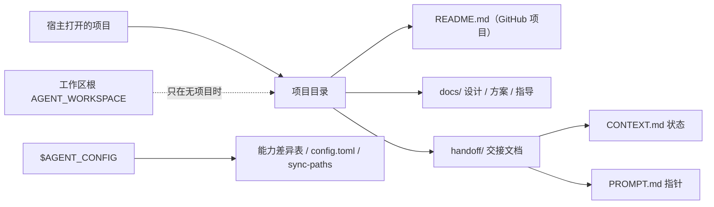
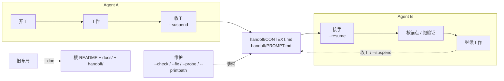
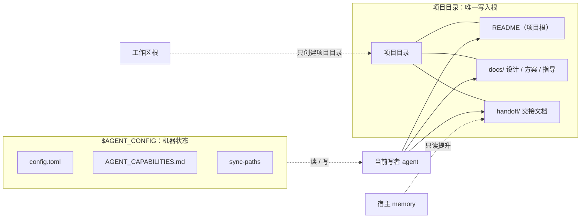
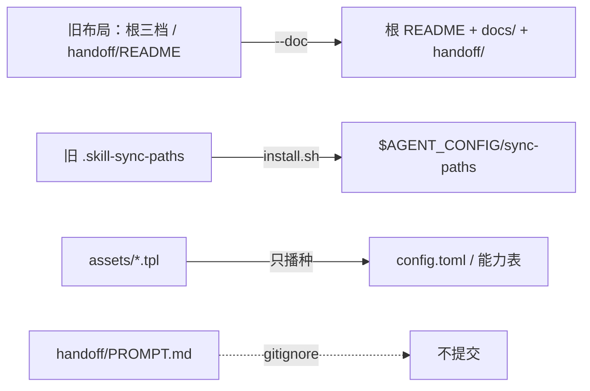
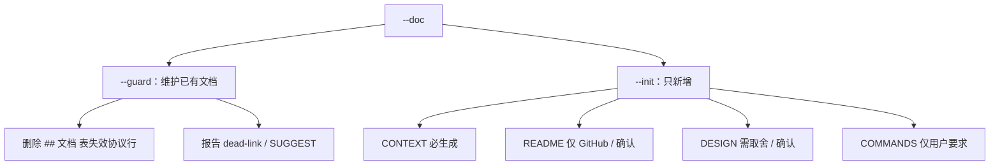

# multi-agent-task-handoff（任务交接）· 方案设计

> 面向改这套协议的人：为什么交接文档固定在 `handoff/`、GitHub 项目 README 固定在根（非 GitHub 按需）、设计/方案类在 `docs/`，以及项目与工作区根怎么分、命令如何收敛、宿主差异如何驱动自动化。
> 状态：已采纳（v4）
> 最近更新：2026-11-06

## 文档
> 只列主要文档与阅读对象；完整索引见 CONTEXT；不复制正文。

| 文档 | 阅读对象 | 内容 |
|---|---|---|
| [README.md](../README.md) | 使用者 | 这是什么、怎么跑、限制 |
| [DESIGN.md](DESIGN.md) | 评审 / 开发 | 摘要、方案、备选、风险、决策（本文） |
| [COMMANDS.md](COMMANDS.md) | 使用者 | 命令参考（可选） |
| [CONTEXT.md](../handoff/CONTEXT.md) | 接手 agent | 完整文档表、当前状态、下一步、记忆提炼、坑 |

完整文档表（含 PROMPT、SKILL、HELP、压卡备份）见 [CONTEXT.md](../handoff/CONTEXT.md)。

## 摘要（Summary）
> 只写问题、方案和为什么现在做。

agent 的上下文易失：换 agent、换宿主、换机器后，接盘的人只能从目录和上一任留下的只言片语猜。这个 skill 把“现在到哪了”写成项目内 `handoff/` 的固定文档，让任何 agent 读文件即可接手；同时用统一布局、显式命令和宿主能力表，把文档整理、交接和宿主差异从“靠记忆”变成“可检查、可迁移的流程”。

## 背景与问题（Motivation）
> 只写问题、影响与约束。

agent 的上下文是易失的：换 agent、换宿主、换机器，接盘的人只能从目录和上一任留下的只言片语猜。靠人记会漏，靠常驻强制会拖慢每轮，靠文档自身又会写成日志；所以需要一个目录内、任何 agent 都能读的最小协议。

## 目标与非目标（Goals / Non-Goals）
> 只写可验证的目标与明确的非目标。

- 目标：所有项目同一套文档布局——GitHub 项目 README 固定在项目根（非 GitHub 按需），设计/方案/指导类在 `docs/`，交接文档在 `handoff/`；交接只发状态和指针；能自动的自动做，做不到的明确列给用户；宿主差异不写进协议正文。
- 约束：不装常驻服务、不装钩子、不写宿主全局规则、不内嵌模型调用；git 可选；任何 agent 读文件即可介入。
- 非目标：自动记忆、会话回放、AI 摘要、向量检索、强制合规、命令叠加。

## 方案（Proposal）
> 只写整体思路与关键设计，不写实现流水账。

### 核心设计



项目目录是唯一写入根；工作区根只用来新建项目目录。项目文档放根 README 与 `docs/`，交接文档固定放 `handoff/`；机器级状态（能力表、配置、安装注册表）统一放 `$AGENT_CONFIG`。

### 关键流程 / 接口



| 阶段 | 触发 | 动作 | 产出 / 结果 | 边界 |
|---|---|---|---|---|
| 开工 | `--doc [--guard \| --init] [--target DIR]` | 默认挡位 `[defaults].doc=guard`；`--guard` 维护已有文档（删文档表失效协议行，其余只报告）并建议可选角色；`--init` 只新增缺失 CONTEXT（README 仅 GitHub/确认，DESIGN 需取舍确认，COMMANDS 仅用户要求）；设计/方案/指导类迁 `docs/`；交接类迁 `handoff/`；补标记；同意后把 PROMPT 加入 `.gitignore` | README（GitHub 项目）+ `docs/` + `handoff/` | 冲突或判不准 → 出选择题，未选不动；缺失角色只 WARN，不新增/不还原 |
| 工作 | — | 改代码/文档；状态或坑变化时更新 CONTEXT | 可交接的当前状态 | 一个项目同一时间一个写者 |
| 收工 | `--suspend` | 超限先压卡；写现在/下一步/MEMORY 提炼/坑/记录；覆盖 PROMPT；按需读 memory 提炼规则；默认挡位读 `config.toml`；源仓库时末尾对齐副本（安装副本跳过；提交/推送时在其后） | CONTEXT 更新 + PROMPT 覆盖 + 副本对齐 | 默认不动 git；`--commit` 提交协议管理文档（`handoff/` 与带标记文档及其移动/删除）；`--push` 隐含 commit 并调 `scripts/handoff.sh --push`（网络错误 3 次 / 3 秒；Windows 再加 HTTP/1.1 + OpenSSL 回退 3 次）；未确认推送成功写「待推送」 |
| 热交接 | `--post <message> [--new \| --next <ID \| 会话名>]` | 把 message 投给另一个会话；可追加项目目录/HEAD/指针，必须可见标注 | 目标会话收到消息 | 不写卡、不动 git；`--new` 必须绑定项目目录，落 worktree 视为失败 |
| 接手 | `--resume` | PROMPT → CONTEXT → 规则；核对 cwd 与项目目录；核锚点、跑验证；产品文档按需打开 | 恢复上下文 | 冲突以 CONTEXT 为准；cwd 不一致先回主项目或注明 worktree；旧布局提示 `--check` / `--doc` |
| 维护 | `--check` / `--fix` / `--probe` / `--printpath` | 只读检查 / 非文档修复 / 实测能力 / 路径诊断 | 报告或修复 | 默认不提交；文档整理项只报告「需跑 `--doc`」 |
| 迁移 | `--doc` | 先出清单；按 scope 与角色移动；同批改链；git 仓用 `git mv` | 旧布局并入根 / `docs/` / `handoff/` | 判不准问用户；只移动不复制；不扫描全盘 |

异常与不可逆点：

- 没有 `handoff/` 不自动建：先 `--doc`。
- 目标文档已存在且非本协议生成：停，不覆盖、不换路径。
- 交接后旧 agent 停写；同一项目同一时间一个写者。
- `PROMPT` 与 `CONTEXT` 冲突以 `CONTEXT` 为准。
- 默认不操作 git；外部可见动作必须显式 `--commit` / `--push`。
- 文档的增、删、迁移只在 `--doc`；其他命令只修改已有文档。
- 安装、副本同步与配置不在这条线上：见附录 A。

一次只用一个命令；`--workspace` 可与一个命令同用，`--nosave` 只跟 `--workspace`。

### 已定语义与边界



| 主题 | 约定 |
|---|---|
| 写入根 | 项目目录；工作区根永远不直接写 `handoff/` |
| 文档路径 | 根 `README.md`（GitHub 项目；其他按需）；`docs/<设计/方案/指导>.md`（含可选 `docs/COMMANDS.md`）；`handoff/{CONTEXT,PROMPT,COMPACT_BACKUP}.md` |
| 归属标记 | 末行隐藏注释 `scope=root\|docs\|handoff`；目录必须与 scope 一致；无标记文档协议只读 |
| 冲突 | 目标已存在且非本协议生成 → 停，不覆盖、不换路径 |
| 交接卡 | CONTEXT ≤100 行；交接记录 ≤10 条；坑类别 ≤10；MEMORY 提炼只放影响下一家的规则；只记关键动作 |
| PROMPT | 每次覆盖；带生成时间；默认 gitignore（`--check` 查未忽略/已跟踪，`--fix` 补规则或取消跟踪）；不写真实会话 ID |
| 命令 | 一次一个；`--workspace` 可搭配一个命令，`--nosave` 只跟 `--workspace`；子参数只跟所属命令 |
| 投递 | `--post <message> [--new \| --next <ID \| 会话名>]`；不写卡、不动 git；`--new` 必须绑定当前项目目录，落 worktree 视为失败；`--next` 支持会话名，唯一命中才用；目标 stopped/completed 且不自动唤醒时给手动卡，不盲目入队 |
| git | 默认不操作；`--commit` 提交协议管理文档（`handoff/` 与带标记文档及其移动/删除）；`--push` 隐含 commit 并调 `scripts/handoff.sh --push`（普通项目推当前目录仓库，源仓库环境推源仓库；网络错误 3 次 / 3 秒；Windows 再加 HTTP/1.1 + OpenSSL 回退 3 次）；不装钩子；未确认推送成功写「待推送」 |
| memory | 只读提升；不复制、不写回；项目内 memory 必须 gitignore |
| GitHub | README 固定在根，首页直接显示；不生成 `.github/README.md`；不用 symlink |
| 一个写者 | 同一项目同一时间一个 agent 写；交接后旧 agent 停写 |
| 跨任务规则 | 项目目录 → 父目录 → `$AGENT_CONFIG/PROJECT_RULES.md` |
| 能力表 | `$AGENT_CONFIG/AGENT_CAPABILITIES.md`；差异表驱动，协议不写宿主分支；Host/版本只记宿主/框架，Provider/模型进本机环境；`--probe` 按 `assets/PROBE.md` 固定清单执行 |
| 机器级状态 | `config.toml`、`AGENT_CAPABILITIES.md`、`sync-paths` 统一放 `$AGENT_CONFIG`；工作区根只放规则与入口 |
| 触发分层 | 上下文注入（`AGENTS.md` 读序）+ 显式命令（接手/收工，含副本同步与 push）；无后台触发；`AGENTS.md` 只做指针 |
| 换机迁移 | 能力表整表带走，只重填「本机环境」块；`AGENTS.md` / `PROJECT_RULES.md` 复制；`sync-paths` 与宿主 memory 不带；`config.toml` 只改 workspace |
| 迁移范围 | 所有项目级文档按角色迁移：README（若存在）留根；设计/方案/指导类进 `docs/`；交接类进 `handoff/`；客制化名同样按类迁移，不留在根 |
| 迁移判定 | V1/V2/V3 三档特征两条同时满足：文件名符合模板（含旧名 压卡备份.md、COMPACTION_BACKUP.md），标题含项目目录名（含义一致即可，如 color-duel 的「变色对决」）；不命中的设计/方案类按角色判定，判不准问用户 |
| 完成定义 | 文档与安装副本一致；`--help` 与命令表一致；`--check` 无 ⛔；当前宿主 probe 必测格无「待测」；卡 ≤100 行；根目录若存在项目文档 `.md`，只能是 `README.md`（包文件 `SKILL.md` 除外） |

### 数据、兼容性与迁移

- 旧布局：由 `--doc` 迁移，只移动、不复制；迁移造成的相对链接与 CONTEXT 文档表同批修正。
- 旧安装注册表：`install.sh` 在实际安装并登记时把 `<repo>/.skill-sync-paths` 一次性迁到 `$AGENT_CONFIG/sync-paths` 后删除；`--printpath` / `--dryrun` 只提示，不迁移。
- 配置：模板只播种、不覆盖；不设无消费者的 `version` 字段；`[defaults]` 的键用 `--gear` 读写，非法值不修改。
- `handoff/PROMPT.md` 默认 gitignore；`--check` 查未忽略/已跟踪，`--fix` 补规则或取消跟踪。



### 工程约束

- 一次只用一个命令；不提供 `+` / 空格叠加。
- 参数名不带中间连字符：`--dryrun`、`--syncall`、`--noregister`；多词直接连写。
- `SKILL.md` 单文件，硬上限 150 行、目标 120；超出才拆 `references/`。
- 协议护栏（冲突停、不搬活会话、单写者、memory 只读）必须留在 `SKILL.md`，不能只放 `PROJECT_RULES.md` 或 README。
- 修 bug 优先结构性根治：脚本守卫、收敛动作/权限面、状态隔离；不要用记忆或追加散文规则修补；跨 agent 的问题必须落在安装副本可执行的机制上。
- 衍生挡位统一写成 `--命令 [--模式 ...]`，默认值放 `[defaults].<命令>`，用 `--gear <命令>=<模式>` 修改；SKILL 标题与 `--help` 写全签名，不用 `--命令-模式` 形式。
- 宿主差异只进 `$AGENT_CONFIG/AGENT_CAPABILITIES.md`；`SKILL.md` 只举例，不写宿主专属规则。
- 宿主识别只做粗分（环境变量）；包装版（cc-haha 等）的差异进能力表 Host/版本与备注，协议不写宿主分支。
- `--probe` 固定清单放 `assets/PROBE.md`；`SKILL.md` 只留指针、确认粒度与完成定义；live 先出计划，确认一次后跑完全部适用项，仅计划外副作用停。
- 旧仓迁移是逐项目人工动作，不默认扫描全盘；先 `--check` 出清单，再由 `--doc` 迁移。
- 迁移按角色处理所有项目级文档：README（若存在）留根，设计/方案/指导类进 `docs/`，交接类进 `handoff/`；客制化名同样迁移，不留在根。判不准时给选项，不自行决定。
- 文档增删迁移只在 `--doc`；先跑 `scripts/handoff.sh --doc --guard`，只删 `## 文档` 表中的失效协议行，其余 WARN/SUGGEST 只报告；只修迁移造成的链接/标记问题，不改正文/历史/项目内容的死链、旧路径或历史内容；内容创建只走 `--doc --init`，只新增、不重建/还原；`--fix` 不搬、不建、不删文档。
- README 若存在必须在根目录；不生成 `.github/README.md` 或 `docs/README.md`。
- 安装只装 HEAD；工作树未提交时只装上一个 commit。
- 状态以 git 为准：未确认推送成功，不写「已推送」；卡与指针记「已提交，待推送」或实际结果。
- `.gitignore` 只增 `handoff/PROMPT.md`，不改项目其他忽略规则；已跟踪的文件先 `git rm --cached` 取消跟踪，再提交。
- `scripts/handoff.sh --push` 在源仓库环境推源仓库，在安装副本环境推当前目录仓库；只重试网络类错误（TLS / reset / timeout 等）；认证失败、非快进、保护分支立即失败。
- 换机迁移只带知识，不带本机状态：能力表本身可搬（覆盖模板），`sync-paths` 重建，宿主 memory 不搬，`PROMPT.md` 不带走。
- 机器级状态只放 `$AGENT_CONFIG`，不放仓库；仓库里不留 `.skill-sync-paths`；状态文件只写有读取方的字段，`.skill-version` 只留 `commit` / `source`。
- 注册表迁移只在 `install.sh` 实际安装并登记的 `register=1 && is_git=1` 分支执行；只读命令与 `--dryrun` 不写注册表。
- 已删除钩子；worktree、外部宿主或本地 git 配置都不再影响同步与 push。
- 模板只播种、不覆盖：缺失的 `AGENT_CAPABILITIES.md` / `AGENTS.md` / `PROJECT_RULES.md` 可确认后从模板创建；已存在的不改写，只报过期。
- 文档只留单一事实源：协议在 `SKILL.md`、取舍在 `docs/DESIGN.md`、状态在 `handoff/CONTEXT.md`；其他文件用指针，不复制正文。
- 文档头块统一：用途 → 阅读对象 → 最近更新/生成时间 → 项目目录 → 源/生成关系；正文不重复这些元数据。
- 文档分工：README 只答“是什么 / 怎么用”，COMMANDS 只答命令参考，SKILL 只答“怎么做”，DESIGN 只答“为什么”，CONTEXT 只答“现在在哪”；进度与待办只进 CONTEXT。
- 命令参考只进 `docs/COMMANDS.md`；README 只留工作流，DESIGN 只留取舍，SKILL 只留协议；COMMANDS 仅在用户明确要求时生成。
- 别名与命令并列写作「别名 / 命令」（斜杠两侧空格，命令用反引号）；同义别名列举写作「接盘/接手」（不加空格）。
- `--printpath` 是视图不是存储：现读环境变量、`.skill-version`、`git config`，不生成缓存文件。
- 批量循环只用 POSIX sh 内建（`while read`、`printf '%.7s'`）：Git Bash 每个外部进程约 0.9 秒，副本多时会把同步拖慢。
- 版本表只列主版本，小版本进 `CONTEXT.md` 记录与 `COMPACT_BACKUP.md`；废弃表按阶段追加；`CONTEXT.md` 的坑平时可追加，`--suspend` 时归并成 ≤10 类；`--check` 只报行数/记录数/类别超限，不自动改写。

### --doc 的 guard / init



guard 只写 `## 文档` 表；init 只从模板新增；两者都不恢复正文。

## 备选方案（Alternatives）
> 只写考虑过但没选的方案与原因；已实施后废弃的方案见附录 C「已废弃方案」。

| 考虑过的方案 | 为什么没选 | 现在的选择 |
|---|---|---|
| 强制层（闸门、看门狗、全局规则） | 每轮变慢、卡长成日志，成本高于收益 | 最小协议 + 显式命令 |
| 根目录三档 / `handoff/README` + `handoff/DESIGN` | 接手只读 PROMPT/CONTEXT，三档副本无人读，且与产品文档重复 | 统一布局：根 README + `docs/` + `handoff/` |
| `.github/README.md` 副本或 symlink | 根 README 已能被 GitHub 原生显示；副本会漂移 | README 固定在根 |
| `post-commit` 自动 push / 钩子兜底同步 | 与「默认不操作 git」冲突；外部宿主可反复改写 | `--save` / `--suspend` 显式提交、同步、推送 |
| `--suspend <ID>` 投递 | 投递与收工耦合，无法在不写卡时投递 | `--post <message>` |
| `--doc` 直接创建/恢复内容 | 越界改正文，无法跨 agent 约束 | `--doc --guard` 只维护协议表 + `--doc --init` 只新增 |
| cwd 即项目根 | 多仓 / 散落仓 / Ubuntu 下不成立 | 项目目录是唯一写入根 |
| 工作区根当产物根 | 会把 `handoff/` 写到容器 | 工作区根只做容器 |

## 风险、代价与缓解（Risks / Drawbacks）
> 只写最坏情况、代价与缓解。

| 风险 / 代价 | 影响 | 缓解 / 接受理由 |
|---|---|---|
| 忘记显式收工 | 没有交接卡，下一家从零猜 | 接受；`--check` 报 PROMPT 过期，入口提示读序 |
| 不装钩子 / 后台服务 | 普通提交不同步副本 | 接受；用 `--save` / `--suspend` 显式同步 |
| 宿主差异（worktree、会话 API、memory） | `--post --new` 或读回可能失败 | 能力表 + `--probe` 清单；落 worktree 拒绝；L2 需临时会话/项目，清理失败只报告 |
| 长会话缓存旧 skill 文本 | 可能按旧规则执行 | `--doc --guard` 扫描/维护；仍需宿主重新加载（开放问题） |
| 非 GitHub 项目 README 缺失但被引用 | 断链或误恢复 | `--doc --guard` 删文档表失效行、正文只报告；`--doc --init` 只新增 |
| 配置模板不覆盖已有文件 | 新键 / 注释不自动同步 | `--check` 或人工更新；无 version；`--gear` 显式改 |
| 跨会话消息队列 | `queued` ≠ 已消费；stopped 不唤醒 | 发送后 `WaitSessions` / `ReadSession` 读回，不以入队为成功 |

## 开放问题（Open Questions）
> 只写还没定的设计问题，不写待办。

- [ ] Ubuntu/Linux、非 git、空格路径是否全部成立？
- [ ] 其他宿主 `--post --new` 的落点与读回是否可用？
- [ ] 长会话如何保证加载当前 `SKILL.md` 文本？
- [ ] `--doc --init` 是否值得脚本化（目前由 agent 执行）？
- [ ] 配置 schema 变化是否需要版本号 + 迁移机制？

## 决策与后果（Decision / Consequences）
> 只写最终决策与后果。

| 决策 | 理由 | 后果 / 代价 |
|---|---|---|
| 统一布局：GitHub 项目根 README + `docs/` + `handoff/`；非 GitHub 项目 README 按需 | 不按项目类型猜路径；GitHub 原生显示根 README；非 GitHub 项目不必为首页造文档 | 旧项目要迁一次并改链；README 生成需判断 remote/用户意图 |
| 交接文档固定在 `handoff/` | 路径唯一，避免与项目自有文档混放 | 不在项目根直接可见，依赖 skill 入口或指针 |
| GitHub 项目 README 固定在根，不生成副本 | GitHub 原生显示根 README；无副本漂移，也不需要判断 remote | GitLab/Gitee/npm 同样读根，无额外收益 |
| 项目目录是唯一写入根 | 多仓/AOSP 场景下不会把卡写到工作区根 | 无项目时要先建目录 |
| 工作区根只做容器 | 与“产物根”区分，避免把 `handoff/` 写到容器 | 用户要理解两个概念的区别 |
| 命令一次只用一个 | 组合过长、顺序和冲突难维护 | 需要多步时分开跑 |
| `--doc` 独占文档增删迁移 | 结构操作集中，其他命令不会意外搬文件；只修迁移造成的链接，不改正文/历史内容；内容创建拆到 `--doc --init`，默认挡位 `[defaults].doc=guard` | 迁移必须显式跑 `--doc`；判不准时要问用户；缺失被引用文档由 `--doc --guard` 删文档表失效行、其余只报告 |
| `--post` 与 `--suspend` 分离 | 热交接只传消息，冷交接才落盘；两者可单独使用 | 需要用户提供 message 与目标会话 |
| 交接只发指针 | 跨 agent 不复制聊天历史；PROMPT 可复用 | 目标读不到文件时要附全文 |
| `PROMPT.md` 自动生成并 gitignore | 含会话 ID/本机路径，默认不提交 | 跨机交接要另发内容 |
| 默认不操作 git | commit/push 是外部可见动作 | 要落锚点时必须显式 `--commit`/`--push` |
| 机械动作由显式命令执行 | 钩子依赖本机配置、外部宿主可改；已删除钩子，同步与 push 只由显式命令执行 | 不走 `--save` / `--suspend` 的普通提交不会同步副本 |
| 能力表按差异拆分 | 宿主叫法、目录来源、会话能力各不同 | 表多，首次要填；每次 live 跑 L1+L2，完成格不留「待测」 |
| memory 只读提升 | 保持 `CONTEXT.md` 是唯一可移植真源 | 宿主记忆的细节不自动搬运 |
| 归属标记用末行隐藏注释 | 不污染公开页面；机器可读；无标记即项目自有 | 旧文档未标记时只能靠角色与用户确认 |
| 安装只认当前宿主 | 不替没打开它的 agent 铺副本 | 换宿主要重跑一次 |
| 自动化只留机械动作 | 提示层（入口文件、模型遵守）不可靠；v1 的强制层已证明成本高于收益 | 需要保证的动作靠显式命令；git hook 只作可选加速 |

## 附录 A：架构与目录（可选）
> 只写架构、目录与模块接缝。

### 仓库布局

```text
multi-agent-task-handoff/
├─ SKILL.md                 # 协议正文（包文件，必须在根）
├─ install.sh               # 只安装：宿主识别、target、注册表
├─ 安装.bat                  # Windows 安装入口
├─ scripts/
│  ├─ handoff.sh            # 运行时：--printpath / --doc [--guard|--init] [--target DIR] / --syncall / --push / --save / --gear（读写挡位）
│  ├─ lib.sh                # 共享：配置 / 宿主 / 路径函数
│  └─ 运行时.bat             # Windows 运行时入口
├─ LICENSE
├─ assets/                  # HELP / 模板（含 COMMANDS.md.tpl）/ PROBE.md / 示例
├─ .gitignore
├─ README.md                # 项目说明；scope=root
├─ docs/
│  ├─ DESIGN.md             # 本文件；scope=docs
│  └─ COMMANDS.md           # 命令参考（可选）；scope=docs
└─ handoff/
   ├─ CONTEXT.md            # 当前状态；scope=handoff
   ├─ PROMPT.md             # 自动生成（gitignore）
   └─ COMPACT_BACKUP.md     # 历史
```

包文件（`SKILL.md`、`scripts/`、`install.sh`、`安装.bat`、`assets/`、`LICENSE`）必须在根；GitHub 项目 README 在根（非 GitHub 按需），设计/方案/指导类进 `docs/`，交接文档进 `handoff/`。

### 机器级状态统一放 `$AGENT_CONFIG`

按作用域归属，不按文件类型：

| 文件 | 归属 | 位置 |
|---|---|---|
| `config.toml` | 用户/机器偏好 | `$AGENT_CONFIG/` |
| `AGENT_CAPABILITIES.md` | 各宿主能力实测缓存 | `$AGENT_CONFIG/` |
| `sync-paths` | 本机安装目录注册表 | `$AGENT_CONFIG/` |
| `PROJECT_RULES.md` / `AGENTS.md` | 工作区跨任务规则与入口指针 | 工作区根 |
| `handoff/*` | 任务状态 | 项目目录 |

- `$AGENT_CONFIG`：Linux/macOS `${XDG_CONFIG_HOME:-$HOME/.config}/multi-agent-task-handoff`；Windows `%APPDATA%\multi-agent-task-handoff`；可用 `AGENT_CONFIG` 覆盖。
- `sync-paths` 是“一行一个安装目录”的纯文本，由 `install.sh` 追加；`scripts/handoff.sh --syncall` 是唯一读取路径。
- `--syncall` 只允许从源仓库运行：安装副本没有 HEAD，强行同步会把所有副本写成 `commit=unknown`，等于降级。对齐是整体重装，副本内本地改动会被覆盖。
- 旧位置 `<repo>/.skill-sync-paths` 由 `install.sh` 一次性迁到新位置后删除。
- 三者不合并成一个文件：偏好（人工低频编辑）、能力缓存（Markdown 表）、注册表（工具追加、可重建）的写入者和失败域不同，合并会让 bash 解析变脆，并把“装到哪”和“同步哪些”绑在一起。
- `config.toml` 只放用户选择；可推导的运行时状态（宿主、副本版本、各路径）不写入配置，由 `--printpath` 现算；不设无消费者的 `version` 字段，需要迁移时再加带迁移逻辑的版本号。
- 挡位：`[defaults]` 下的键；显式参数覆盖；`--gear` 可读写，键/默认值/允许值由 `scripts/lib.sh` 映射驱动，`--gear list` 查看，非法值不修改。

### 关键接缝

1. **项目 ↔ 工作区根**：项目目录是写入根；工作区根只建项目目录。
2. **交接文档 ↔ 项目文档**：`handoff/` 放交接文档；根 README 与 `docs/` 放项目文档；所有项目同一布局，旧布局由 `--doc` 迁移，只移不复制。
3. **CONTEXT ↔ PROMPT**：CONTEXT 人维护；PROMPT 自动生成，冲突以 CONTEXT 为准。
4. **能力表 ↔ 自动化**：建会话/绑定目录/切目录/UI 打开/文件迁移/会话搬运分级；未知按手动；测试矩阵见 `assets/PROBE.md`。
5. **memory ↔ 交接**：只读提升；不复制、不写回；位置与读取方式查能力表「memory 读取」。
6. **归属标记 ↔ 目录**：标记声明 scope（root/docs/handoff），所在目录必须一致；无标记文档归项目所有，协议只读。

## 附录 B：测试、发布与运维（可选）
> 只写验证、发布、回滚与维护流程。

面向直接改这个仓库的人，不面向任务使用者。日常只有三件事：提交、推送、同步副本。

### 日常改动流程

1. 改文件；涉及协议/脚本/文档时同步改 `SKILL.md`、`README.md`、`docs/DESIGN.md`、模板，以及各文档头块与章节标题。
2. 自检：`sh -n scripts/lib.sh scripts/handoff.sh install.sh`；`bash install.sh --dryrun`。
3. 诊断：`bash scripts/handoff.sh --printpath`；`bash scripts/handoff.sh --syncall --dryrun`。
4. 保存：`bash scripts/handoff.sh --save`（默认已跟踪文件，新文件 `--all`，消息 `-m`）。
5. 核对：`git status -sb` 无 ahead；`scripts/handoff.sh --printpath` 副本全部「当前」。

`--save` 内部依次：`git add` → `git commit` → `--syncall` → `--push`（网络错误重试）。普通 `git commit` 不会自动同步副本。

自动化边界：**流程编排全部由人触发；自动化只发生在命令内部。** `--probe --live` 仍由 agent 执行；计划确认一次后，命令内动作按清单全自动。

| 步骤 | 谁触发 | 谁执行 | 性质 |
|---|---|---|---|
| 改文件 | 人 | 人 / agent | 手动 |
| 自检 | 人 | 脚本 | 手动触发，自动检查 |
| 诊断 | 人 | 脚本 | 手动触发，自动读取 |
| 保存 | 人 | `scripts/handoff.sh --save` | 手动触发；命令内提交、同步、推送重试 |
| 核对 | 人 | 脚本 | 手动触发，自动检查 |


黄=人工判断；绿=人工触发、命令自动执行；`--save` 框内是命令内部动作，没有外部触发。

### 两条提交路径

| 场景 | 命令 | 提交范围 | 同步 |
|---|---|---|---|
| 直接维护仓库 | `scripts/handoff.sh --save` | 已跟踪文件（`--all` 含新文件） | 命令内自动 |
| 任务收工 | `--suspend`（挡位读 `[defaults].suspend`；显式 `--local` / `--commit` / `--push`） | 协议管理文档：`handoff/` 与带标记文档及其移动/删除 | 收工末尾自动 `--syncall`（仅源仓库；安装副本跳过） |

- `scripts/handoff.sh --push` 在源仓库环境推源仓库、安装副本环境推当前目录仓库；只重试网络错误；认证失败、非快进、保护分支立即失败。
- `--suspend` / `--probe` / `--post` 的默认值分别读 `[defaults].suspend` / `.probe` / `.post`；`--doc` 默认挡位读 `[defaults].doc`（guard / init，默认 guard）；`--gear` 可读写这些键。
- 推送失败时，卡与指针写「待推送」；不 force push，分叉先停下报告。

### 发布边界

- 包文件必须在根：`SKILL.md`、`scripts/`、`install.sh`、`安装.bat`、`assets/`、`LICENSE`。
- 改 `scripts/lib.sh` / `scripts/handoff.sh` 后必须 `--syncall`，否则安装副本仍是旧入口。
- `.bat` 必须 CRLF；仓库用 `*.bat text eol=crlf`，`git archive` 会按属性输出。
- 普通提交不会自动同步副本；同步由 `--save` / `--suspend` 显式执行。

## 附录 C：版本与演进（可选）
> 只列主版本；小版本进 CONTEXT / COMPACT_BACKUP。

旧版代码已从工作树删除；这里只留设计演进。2026-10-29 公开发布前用 git-filter-repo 脱敏重写历史，旧哈希失效。

维护：版本表只列主版本，小版本与逐条变更只进 `CONTEXT.md` 的交接记录与 `COMPACT_BACKUP.md`；不写跨版本总结句（总结会过时），主线由各行「理念更替」与「理由与结果」自然连成。废弃方案表按阶段累计，被否决的方案保留理由和替代，避免重新讨论。

### 主版本表

| 版本 | 时间 | 理念更替 | 理由与结果 |
|---|---|---|---|
| v1 | 2026-10-08–16 | 用强制层保证交接：闸门、安装器、看门狗 | 闸门和看门狗确实保证了文档存在，但每轮变慢、卡长成日志；强制层的成本高于收益，整体卸载。 |
| v2 | 2026-10-23–29 | 从「强制规范」转向「最小协议」，并对外可用 | 强制层卸载后交接仍然需要，但多数任务不需要三档：改为默认一卡、三档按需。对外发布要求路径不绑作者机器，因此有 `AGENT_WORKSPACE`、MIT 和历史脱敏。 |
| v3 | 2026-11-03–05 | 从「cwd 即任务根」转向「项目目录」；机械动作从钩子收归显式命令；知识与本机状态分离 | cwd 在多仓 / 散落仓 / Ubuntu 下不成立，改项目目录；钩子会被外部宿主改写，同步与 push 收归显式命令；机器状态散落，能力表与知识分离；入口按动作拆入 `scripts/`。 |
| v4 | 2026-11-06 | 从「任务文档三档」转向「统一布局 + 归属标记」；文档整理收归 `--doc`；新增 `--post` 热交接 | 接手 agent 实际只读 PROMPT 与 CONTEXT，三档导致 README/DESIGN 在 `handoff/` 与产品文档重复；改为 GitHub 项目 README 在根（非 GitHub 按需）、设计/方案/指导类进 `docs/`、交接文档留 `handoff/`，模板末行标记自我声明；不再生成 `.github/README.md`；`--suspend` 去掉 `<ID>`，投递改由 `--post` 承担。 |

### 已废弃方案

按阶段累计；这里只记已实施后废弃的方案，核心「备选方案」只列考虑过但没选的。被否决的方案保留理由，替代注明落点。

| 阶段 | 废弃方案 | 否决原因 | 替代 |
|---|---|---|---|
| v1 | 闸门、`init-task.sh`、`check-docs.sh`、`pre-push`、每日看门狗、全局规则与三处副本 | 强制层保证文档存在，成本高于收益：每轮变慢，卡长成日志 | 删掉强制层（v2） |
| v1 | 默认三档 + 自动铺满 | 文档必然膨胀；多数任务不需要三档 | 默认单档，三档显式 `--doc` |
| v1 | 双锚、出处戳、夹具/变异测试 | 服务于强制层，随强制层一起卸载 | 状态锚点 + 验证命令 |
| v2 | cwd 即任务根 | 多仓 / 散落仓 / Ubuntu 下不成立 | 项目目录（v3） |
| v2 | 根目录三档（仓库根放 CONTEXT/README/DESIGN） | 与项目自有文档冲突；GitHub 识别路径不稳 | `handoff/`（v3） |
| v2 | 作者实机调研快照 + 同步脚本 | 一次性调研不能当真相源；副本会漂移 | 能力表 + `--probe`（v3） |
| v2 | 工作区根能力表副本、仓库内 `.skill-sync-paths` | 机器状态散落、双份易漂移 | 单一 `$AGENT_CONFIG`（v3） |
| v3 | `docs/` / `docs/handoff/` | 与项目自有 docs 冲突；GitHub 识别路径不稳定 | 固定 `handoff/` |
| v3 | 根 README 生成 | 会与项目自己的根 README 冲突 | 有 remote 时生成 `.github/README.md` |
| v3 | `.github` symlink | Windows 不稳定；会抢项目首页；相对链接易坏 | 生成 `.github/README.md` |
| v3 | agent 主动打开文件夹并迁移会话 | 多数宿主不支持搬运活会话 | 新建会话 + `PROMPT.md` 指针 |
| v3 | 工作区 = 宿主打开的文件夹；草稿根 = `AGENT_WORKSPACE` | 与最终定义冲突（评审第 1 条被后续纠正推翻） | 项目目录写、工作区根只作容器 |
| v3 | `--coding`、命令叠加 | 名字歧义；组合顺序难维护 | `--doc`；一次只用一个命令 |
| v3 | `post-commit` 自动 push + 靠 `SKIP_AUTO_PUSH` 抑制 | 与「默认不操作 git」冲突；普通提交会静默推送 | push 只由 `--push` 显式执行（v3） |
| v3 | 靠 `--check` / `--fix` 恢复 `core.hooksPath` 兜底同步 | 外部宿主可反复改写，兜底会常态化 | 同步收归 `--suspend`；钩子降为可选（v3） |
| v4 | 三档任务文档（`handoff/README.md` + `handoff/DESIGN.md`） | 接手只读 PROMPT/CONTEXT，三档副本无人读，且与产品文档重复 | 统一布局；设计/方案类进 `docs/`（v4） |
| v4 | 生成 `.github/README.md` 当首页 | 根 README 已能被 GitHub 原生显示；副本会漂移，且会抢项目自己的首页 | README 固定在根（v4） |
| v4 | 单档/三档模式与「模式：」头块 | 每个项目都可补齐三档，模式标记不再有意义 | `--doc` 补缺失角色；标记只表 scope（v4） |
| v4 | `--suspend <ID>` 发指针 | 投递与收工耦合，无法在不写卡时投递 | `--post <message>`（v4） |
| v4 | `--fix` 迁移旧布局 | 修改与结构变更混在一个命令，容易误搬 | 增删迁移收归 `--doc`（v4） |

注：v3 否决的是把 `docs/` 当交接文档目录（`docs/handoff/`）；v4 的 `docs/` 只放设计/方案/指导类，交接文档仍固定在 `handoff/`，两者不冲突。

## 附录 D：术语（可选）
> 只定义容易混淆的词；不写同义词表。

| 术语 | 定义 | 不是什么 |
|---|---|---|
| 项目 | 宿主 UI 的工作单元：Claude 项目、Qoder 工作区、WorkBuddy 空间、OpenCode/ZCode/Codex 项目 | 不是 `AGENT_WORKSPACE` |
| 项目目录 | 项目的绝对路径；唯一写入根；可为已打开项目或新建项目目录 | 不是工作区根 |
| 工作区根 | `AGENT_WORKSPACE` 容器；只用来新建项目目录 | 不是写入目标 |
| 当前目录 | `pwd`；可 `cd` | 不改变项目 |

判定：宿主给出打开目录就用它；否则用会话启动时的 `pwd`；打开的目录等于工作区根 / `$HOME` / 盘根 / 临时目录时不算项目，先在工作区根下新建项目目录；不按 git 根自动上溯。

<!-- multi-agent-task-handoff: scope=docs -->
