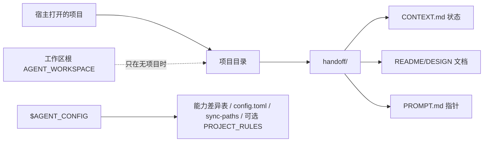

# multi-agent-task-handoff（任务交接）· 方案设计

> 面向改这套协议的人：为什么任务文档固定在 `handoff/`、项目与工作区根怎么分、命令如何收敛、宿主差异如何驱动自动化。
> 文档表见 [CONTEXT.md](CONTEXT.md)；使用者说明见 [README.md](README.md)，协议正文见 [SKILL.md](../SKILL.md)。
> 最近更新：2026-11-04

## 1. 目标与约束

会话是易失的：换会话、换 agent、换机器，接盘的人只能从目录和上一段会话猜。靠人记会漏，靠常驻强制会拖慢每轮，靠文档自身又会写成日志；所以需要一个目录内、任何 agent 都能读的最小协议。

目标：任务文档固定在项目目录的 `handoff/`；交接只发状态和指针；能自动的自动做，做不到的明确列给用户；宿主差异不写进协议正文。

约束：不装常驻服务、不写全局规则、不调用模型；git 可选；任何 agent 读文件即可介入。

非目标：自动记忆、会话回放、AI 摘要、向量检索、强制合规、命令叠加。

## 2. 术语

| 术语 | 定义 | 不是什么 |
|---|---|---|
| 项目 | 宿主 UI 的工作单元：Claude 项目、Qoder 工作区、WorkBuddy 空间、OpenCode/ZCode/Codex 项目 | 不是 `AGENT_WORKSPACE` |
| 项目目录 | 项目的绝对路径；唯一写入根；可为已打开项目或新建项目目录 | 不是工作区根 |
| 工作区根 | `AGENT_WORKSPACE` 容器；只用来新建项目目录 | 不是写入目标 |
| 当前目录 | `pwd`；可 `cd` | 不改变项目 |

判定：宿主给出打开目录就用它；否则用会话启动时的 `pwd`；打开的目录等于工作区根 / `$HOME` / 盘根 / 临时目录时不算项目，先在工作区根下新建项目目录；不按 git 根自动上溯。

## 3. 运行模式与拓扑



## 4. 核心流程

命令流程见 [SKILL.md](../SKILL.md)：`--resume` 读卡核锚点，`--suspend` 压卡/写卡/写指针，`--doc` 补三档，`--check`/`--fix` 检查修复，`--probe` 实测能力。

一次只用一个命令；`--workspace` / `--nosave` 是全局选项。

## 5. 架构与关键接缝

### 5.1 仓库布局

```text
multi-agent-task-handoff/
├─ SKILL.md                 # 协议正文（包文件，必须在根）
├─ install.sh               # 安装：宿主识别、config、--printpath、--syncall
├─ 安装.bat                  # Windows 双击入口，调用 install.sh
├─ LICENSE
├─ assets/                  # HELP / 模板 / 示例
├─ .github/README.md        # 由 handoff/README.md 生成
├─ .githooks/post-commit    # 同步安装副本 + 自动 push
├─ .gitignore
└─ handoff/
   ├─ README.md             # 产品/任务 README 源
   ├─ DESIGN.md             # 本文件
   ├─ CONTEXT.md            # 当前状态
   ├─ PROMPT.md             # 自动生成（gitignore）
   └─ 压卡备份.md            # 历史
```

包文件（`SKILL.md`、`install.sh`、`安装.bat`、`assets/`、`LICENSE`、`.githooks/`）必须在根；任务文档进 `handoff/`。

#### 5.1.1 机器级状态统一放 `$AGENT_CONFIG`

按作用域归属，不按文件类型：

| 文件 | 归属 | 位置 |
|---|---|---|
| `config.toml` | 用户/机器偏好 | `$AGENT_CONFIG/` |
| `AGENT_CAPABILITIES.md` | 各宿主能力实测缓存 | `$AGENT_CONFIG/` |
| `sync-paths` | 本机安装目录注册表 | `$AGENT_CONFIG/` |
| `PROJECT_RULES.md` / `AGENTS.md` | 工作区跨任务规则与入口指针 | 工作区根 |
| `handoff/*` | 任务状态 | 项目目录 |

- `$AGENT_CONFIG`：Linux/macOS `${XDG_CONFIG_HOME:-$HOME/.config}/multi-agent-task-handoff`；Windows `%APPDATA%\multi-agent-task-handoff`；可用 `AGENT_CONFIG` 覆盖。
- `sync-paths` 是“一行一个安装目录”的纯文本，由 `install.sh` 追加；`--syncall` 与 `post-commit` 都读它。
- `--syncall` 只允许从源仓库运行：安装副本没有 HEAD，强行同步会把所有副本写成 `commit=unknown`，等于降级。
- 旧位置 `<repo>/.skill-sync-paths` 由 `install.sh` / `post-commit` 一次性迁到新位置后删除。
- 三者不合并成一个文件：偏好（低频编辑）、能力缓存（Markdown 表）、注册表（高频追加）的读写方式不同，合并会让 bash 解析变脆。

### 5.2 关键接缝

1. **项目 ↔ 工作区根**：项目目录是写入根；工作区根只建项目目录。
2. **任务文档 ↔ 项目文档**：`handoff/` 是任务文档；根 README/DESIGN 是项目文档，不自动搬。
3. **CONTEXT ↔ PROMPT**：CONTEXT 人维护；PROMPT 自动生成，冲突以 CONTEXT 为准。
4. **能力表 ↔ 自动化**：建会话/绑定目录/切目录/UI 打开/文件迁移/会话搬运分级；未知按手动。
5. **memory ↔ 交接**：只读提升；不复制、不写回；位置与读取方式查能力表「memory 读取」。
6. **生成物 ↔ 真源**：`.github/README.md` 是生成物；源文件是 `handoff/README.md`。

## 6. 关键设计决策

| 决策 | 理由 | 代价 |
|---|---|---|
| 任务文档固定在 `handoff/` | 路径唯一，避免 `docs/` 碰撞和多套兜底 | 不在项目根直接可见，依赖 skill 入口或指针 |
| 项目目录是唯一写入根 | 多仓/AOSP 场景下不会把卡写到工作区根 | 无项目时要先建目录 |
| 工作区根只做容器 | 与“产物根”区分，避免把 `handoff/` 写到容器 | 用户要理解两个概念的区别 |
| 命令一次只用一个 | 组合过长、顺序和冲突难维护 | 需要多步时分开跑 |
| `--doc` 只补文档 | 不建兄弟目录、不迁移代码 | 旧布局要靠 `--fix` 迁移 |
| 交接只发指针 | 跨 agent 不复制聊天历史；PROMPT 可复用 | 目标读不到文件时要附全文 |
| `PROMPT.md` 自动生成并 gitignore | 含会话 ID/本机路径，默认不提交 | 跨机交接要另发内容 |
| 默认不操作 git | commit/push 是外部可见动作 | 要落锚点时必须显式 `--commit`/`--push` |
| 能力表按差异拆分 | 宿主叫法、目录来源、会话能力各不同 | 表多，首次要填 |
| memory 只读提升 | 保持 `CONTEXT.md` 是唯一可移植真源 | 宿主记忆的细节不自动搬运 |
| `.github/README.md` 由 `handoff/README.md` 生成 | GitHub 首页只认 `.github`/根/`docs` | 会覆盖根 README 的首页展示 |
| 安装只认当前宿主 | 不替没打开它的 agent 铺副本 | 换宿主要重跑一次 |

## 7. 已定语义与边界

| 主题 | 约定 |
|---|---|
| 写入根 | 项目目录；工作区根永远不直接写 `handoff/` |
| 文档路径 | `<项目目录>/handoff/{CONTEXT,README,DESIGN,PROMPT,压卡备份}.md` |
| 冲突 | 目标已存在且非本协议生成 → 停，不覆盖、不换路径 |
| 交接卡 | CONTEXT ≤100 行；交接记录 ≤10 条；坑类别 ≤10；只记关键动作 |
| PROMPT | 每次覆盖；带生成时间；默认 gitignore；不写真实会话 ID |
| 命令 | 一次一个；`--workspace`/`--nosave` 全局；子参数只跟所属命令 |
| git | 默认不操作；`--commit` 只提交 `handoff/`；`--push` 隐含 commit |
| memory | 只读提升；不复制、不写回；项目内 memory 必须 gitignore |
| GitHub | 有 remote 即生成 `.github/README.md`；无 remote 不生成；不用 symlink |
| 一个写者 | 同一项目同一时间一个会话写；交接后旧会话停写 |
| 跨任务规则 | 项目目录 → 父目录 → `$AGENT_CONFIG/PROJECT_RULES.md` |
| 能力表 | `$AGENT_CONFIG/AGENT_CAPABILITIES.md`；差异表驱动，协议不写宿主分支 |
| 机器级状态 | `config.toml`、`AGENT_CAPABILITIES.md`、`sync-paths` 统一放 `$AGENT_CONFIG`；工作区根只放规则与入口 |
| 触发分层 | 上下文注入（`AGENTS.md` 读序）+ 显式命令（接手/收工）+ 机械动作（`post-commit`）；`AGENTS.md` 只做指针，不触发机械动作 |
| 换机迁移 | 能力表整表带走，只重填「本机环境」块；`AGENTS.md` / `PROJECT_RULES.md` 复制；`sync-paths` 与宿主 memory 不带；`config.toml` 只改 workspace |
| 迁移范围 | 只迁符合模版的同名任务文档（`CONTEXT` / `README` / `DESIGN` / `压卡备份`）；客制化名文档（`实施方案`、`架构设计` 等）留根，由 `CONTEXT` 的文档表用 `../` 引用 |
| 迁移判定 | root `CONTEXT.md` 存在且 `模式：三档`，或文档带模版特征；产品 README/DESIGN 不动 |
| 完成定义 | 文档与安装副本一致；`--help` 与命令表一致；`--check` 无 ⛔；卡 ≤100 行 |

## 8. 工程约束

- 一次只用一个命令；不提供 `+` / 空格叠加。
- `SKILL.md` 单文件，硬上限 150 行、目标 120；超出才拆 `references/`。
- 协议护栏（冲突停、不搬会话、单写者、memory 只读）必须留在 `SKILL.md`，不能只放 `PROJECT_RULES.md` 或 README。
- 宿主差异只进 `$AGENT_CONFIG/AGENT_CAPABILITIES.md`；`SKILL.md` 不写宿主分支。
- 旧仓迁移是逐项目人工动作，不默认扫描全盘；先 `--check` 出清单，再 `--fix`。
- 迁移只动同名标准件；客制化交付文档（大方案、架构稿）不搬，避免移动工程产物和大范围改链。
- `.github/README.md` 覆盖根 README 的首页展示是预期行为；要求项目 README 当首页的仓不适用。
- 安装只装 HEAD；工作树未提交时只装上一个 commit。
- 换机迁移只带知识，不带本机状态：能力表本身可搬（覆盖模板），`sync-paths` 重建，宿主 memory 不搬，`PROMPT.md` 不带走。
- 机器级状态只放 `$AGENT_CONFIG`，不放仓库；仓库里不留 `.skill-sync-paths`。
- worktree 会话可能修改共享的 `core.hooksPath`；`--check` 校验，`--fix` 恢复，不静默接受。
- 模板只播种、不覆盖：缺失的 `AGENT_CAPABILITIES.md` / `AGENTS.md` / `PROJECT_RULES.md` 可确认后从模板创建；已存在的不改写，只报过期。
- 文档只留单一事实源：协议在 `SKILL.md`、取舍在 `DESIGN.md`、状态在 `CONTEXT.md`；其他文件用指针，不复制正文。
- 版本表与废弃表只追加行；`CONTEXT.md` 的坑平时可追加，`--suspend` 时归并成 ≤10 类；`--check` 只报行数/记录数/类别超限，不自动改写。

## 9. 版本与设计演进

旧版代码已从工作树删除；这里只留设计演进。2026-10-29 公开发布前用 git-filter-repo 脱敏重写历史，旧哈希失效。

维护：版本表一个主版本一行，只追加、不回填；不写跨版本总结句（总结会过时），主线由各行「理念更替」自然连成。废弃方案表按阶段累计，被否决的方案保留理由和替代，避免重新讨论。

### 9.1 版本表

| 版本 | 时间 | 理念更替 | 结果 |
|---|---|---|---|
| v1.0–v1.2 | 2026-10-08–16 | 用强制层保证交接：闸门、安装器、看门狗 | 文档确实被创建，但每轮变慢、卡长成日志；整体卸载 |
| v2 | 2026-10-23 | 从「强制规范」转向「最小协议」 | 默认一卡，三档按需；git 可选 |
| v2.1 | 2026-10-29 | 对外可用：路径不绑作者机器 | `AGENT_WORKSPACE`、MIT、历史脱敏 |
| v3 | 2026-11-03 | 从「cwd 即任务根」转向「项目目录」；工作区根只作容器；宿主差异决定自动化 | `handoff/`；8 个命令；`config.toml`；能力差异表；memory 只读提升 |
| v3.1 | 2026-11-04 | 能力表是知识、不是本机状态；安装副本没有资格决定 HEAD | `--syncall` 护栏；迁移语义；能力表路径固定 |

### 9.2 已废弃方案

按阶段累计；被否决的方案保留理由，替代注明落点。

| 阶段 | 废弃方案 | 否决原因 | 替代 |
|---|---|---|---|
| v1 | 闸门、`init-task.sh`、`check-docs.sh`、`pre-push`、每日看门狗、全局规则与三处副本 | 强制层保证文档存在，成本高于收益：每轮变慢，卡长成日志 | 删掉强制层（v2） |
| v1 | 默认三档 + 自动铺满 | 文档必然膨胀；多数任务不需要三档 | 默认单档，三档显式 `--doc` |
| v1 | 双锚、出处戳、夹具/变异测试 | 服务于强制层，随强制层一起卸载 | 状态锚点 + 验证命令 |
| v2 | cwd 即任务根 | 多仓 / 散落仓 / Ubuntu 下不成立 | 项目目录（v3） |
| v2 | 根目录三档（仓库根放 CONTEXT/README/DESIGN） | 与项目自有文档冲突；GitHub 识别路径不稳 | `handoff/`（v3） |
| v2 | 作者实机调研快照 + 同步脚本 | 一次性调研不能当真相源；副本会漂移 | 能力表 + `--probe`（v3） |
| v2 | 工作区根能力表副本、仓库内 `.skill-sync-paths` | 机器状态散落、双份易漂移 | 单一 `$AGENT_CONFIG`（v3） |
| v3 | `docs/` / `docs/handoff/` | 与项目自有 docs 冲突；GitHub 识别路径不稳定 | 固定 `handoff/` |
| v3 | 根 README 生成 | 会与项目自己的根 README 冲突 | 有 remote 时生成 `.github/README.md` |
| v3 | `.github` symlink | Windows 不稳定；会抢项目首页；相对链接易坏 | 生成 `.github/README.md` |
| v3 | agent 主动打开文件夹并迁移会话 | 多数宿主不支持搬运活会话 | 新建会话 + `PROMPT.md` 指针 |
| v3 | 工作区 = 宿主打开的文件夹；草稿根 = `AGENT_WORKSPACE` | 与最终定义冲突（评审第 1 条被后续纠正推翻） | 项目目录写、工作区根只作容器 |
| v3 | `--coding`、命令叠加 | 名字歧义；组合顺序难维护 | `--doc`；一次只用一个命令 |
