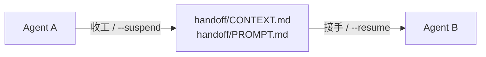

# multi-agent-task-handoff（任务交接）· 使用说明

> 换 agent、换宿主、隔天回来，任务还能接着干：把状态写进项目目录的 `handoff/`，下一个 agent 读卡即可接手。
> 一个 skill、一个目录、一份交接卡；不装常驻服务，不绑定宿主，不复制聊天历史。
> 阅读对象：使用者；本文件是 `handoff/README.md`，任务/产品 README 的唯一源。
> 最近更新：2026-11-05
> 项目目录：`D:\agent_workspace\multi-agent-task-handoff`
> GitHub 首页由本文件生成，不要手改生成物。

## 文档

| 文档 | 阅读对象 | 内容 |
|---|---|---|
| [README.md](README.md) | 使用者 | 这是什么、怎么跑、限制 |
| [DESIGN.md](DESIGN.md) | 评审 / 开发 | 目标、架构、流程、决策 |
| [CONTEXT.md](CONTEXT.md) | 接手 agent | 完整文档表、当前状态、下一步、记忆提炼、坑 |

完整文档表（含 PROMPT、SKILL、HELP、压卡备份）见 [CONTEXT.md](CONTEXT.md)。

## 1. 这是什么

agent 的上下文是易失的。换一个 agent、换一个宿主、隔一天回来，上一个 agent 想过什么、试过什么、卡在哪，全都没了。通常只能翻聊天记录，或者靠人复述。

这个 skill 只做一件事：**把“现在到哪了”写成一份任何 agent 都能读的文件**，放在项目目录的 `handoff/` 里。下一位进来，读它，就能接着干。

适合：

- 一个任务会跨越多个 agent 实例，或者要在不同宿主之间转手；
- 需要留下“为什么这么定、下一步做什么、哪些别动”；
- 想让交接这件事可检查、可迁移，而不是靠记忆。

不适合：

- 纯问答、一次性脚本；
- 已经有完善工单/项目管理流程，且不需要 agent 读上下文的场景。

agent 之间的闭环只有一步：



## 2. 安装

### 2.1 前置

- 支持的宿主：Claude Code / Qoder / OpenCode(OpenChamber) / ZCode / Codex / WorkBuddy；
- 能跑 shell 的环境（Windows Git Bash、Linux、macOS 均可）；
- git 可选：有 git 用 commit 作锚点，没有就用时间戳。

### 2.2 手动安装

```bash
git clone https://github.com/Lizardon386/multi-agent-task-handoff.git
cd multi-agent-task-handoff
bash install.sh --dryrun     # 确认安装目标
bash install.sh               # 只装当前宿主
```

Windows 可直接双击根目录的 `安装.bat`：它自动找 git/bash 并调用 `install.sh`，识别不出宿主时会提示选择。

需要安装到多个宿主时，对每个宿主各执行一次 `--host` 安装；收工时 `--suspend` 会跑 `scripts/handoff.sh --syncall` 对齐各副本，幂等，可随时手动重跑。

Windows 上诊断和同步用 `scripts\运行时.bat --printpath` / `scripts\运行时.bat --syncall`；安装仍用 `安装.bat`。

### 2.3 由 agent 安装

把仓库地址交给 agent，由它执行安装：

```text
克隆 https://github.com/Lizardon386/multi-agent-task-handoff，
先跑 install.sh --dryrun 确认安装目标，再跑 install.sh 只装当前宿主；识别不出宿主就用 --host 指定。
```

agent 会把 skill 安装到当前宿主的 `skills/multi-agent-task-handoff`，把目标登记到 `$AGENT_CONFIG/sync-paths`；首次安装还会创建 `config.toml` 和能力表模板。

## 3. 使用说明

### 3.1 触发方式

- 支持斜杠命令：`/multi-agent-task-handoff <参数>`
- 支持 skill 工具：直接说「接手 / 收工 / 修复」，或从 skill 列表里选
- 都不支持：把 `SKILL.md` 的路径交给 agent，让它按文件协议执行

参数可省略（默认 `--resume`）；完整列表见 `--help`。

### 3.2 常用场景

| 场景 | 说法 / 命令 | 会发生什么 |
|---|---|---|
| 新任务开工 | `--doc` | 在 `<项目目录>/handoff/` 建 CONTEXT，需要时补 README/DESIGN |
| 接手别人的任务 | `接手` / `--resume` | 读 PROMPT → CONTEXT，核锚点、跑验证 |
| 本轮收工 | `收工` / `--suspend` | 按需压卡、写 CONTEXT、覆盖 PROMPT、对齐安装副本；`--push` 网络错误重试 3 次 |
| 交给指定 agent | `--suspend <ID>` | 写卡后按会话 ID 只发一段指针，不贴全文 |
| 体检/修复 | `--check` / `--fix` | 检查安装、布局、配置、链接；`--fix` 修可自动项，含把落后的安装副本快进到当前提交 |
| 摸底宿主能力 | `--probe` | 实测当前 agent 并更新能力表；`--live` 会实际建会话 |
| 路径诊断 | `--printpath` | 表格输出配置目录、工作区根、能力表（含日期）、源仓库、宿主识别来源、全部副本的路径与 commit |

项目第一次用先跑 `--doc` 建档（没有 `handoff/` 不会自动创建）；之后接手 / `--resume` 继续，收工 / `--suspend` 写卡并生成 `PROMPT.md`。

一次只用一个命令。`--suspend` / `--probe` 的默认挡位读 `$AGENT_CONFIG/config.toml` 的 `[defaults]`；显式参数覆盖。安装、配置、GitHub 首页、旧布局迁移的细节见 [DESIGN.md](DESIGN.md) 和 [SKILL.md](../SKILL.md)。

## 4. 产物与目录

```text
<项目目录>/handoff/
├─ CONTEXT.md      # 交接卡：状态、下一步、记忆提炼、坑、记录
├─ README.md       # 任务说明（本文的源）
├─ DESIGN.md       # 设计取舍（需要时）
├─ PROMPT.md       # 交接指针，自动生成，默认 gitignore
└─ COMPACTION_BACKUP.md      # 压卡搬出的历史
```

| 产物 | 位置 | 用途 |
|---|---|---|
| 交接卡 | `handoff/CONTEXT.md` | 下一位 agent 的入口 |
| 交接指针 | `handoff/PROMPT.md` | 发送给接手 agent 的短消息源 |
| 历史归档 | `handoff/COMPACTION_BACKUP.md` | 卡超限时把日志搬出 |
| 能力缓存 | `$AGENT_CONFIG/AGENT_CAPABILITIES.md` | 宿主差异与实测结论 |
| 机器配置 | `$AGENT_CONFIG/config.toml` | 工作区根等偏好 |
| 安装注册表 | `$AGENT_CONFIG/sync-paths` | 本机已安装的宿主副本，`--suspend` 收工时同步 |

项目自己的 `README.md`、`docs/`、源码都不动；任务文档只在 `handoff/`。

## 5. 换机迁移

协议本体随仓库走；机器上另有几样东西要分清带不带：

| 内容 | 位置 | 带不带 |
|---|---|---|
| 能力表 | `$AGENT_CONFIG/AGENT_CAPABILITIES.md` | ✅ 整表带走，覆盖模板；只重填「本机环境」块 |
| 工作区规则 | `<工作区根>/AGENTS.md`、`PROJECT_RULES.md` | ✅ 复制过去；「本机环境」小节重填 |
| 机器偏好 | `$AGENT_CONFIG/config.toml` | 🟡 改掉 `[paths].workspace` 再带 |
| 安装注册表 | `$AGENT_CONFIG/sync-paths` | ❌ 不带，新机器 `install.sh` 自动重建 |
| 宿主 memory | 宿主自己的目录 | ❌ 不搬；有价值的事实已在 `handoff/` |
| 任务状态 | 项目内 `handoff/` | 随项目仓库 clone 即带 |

新机器步骤：

1. `git clone` 本仓库并执行 `install.sh`：会创建模板 `config.toml` 和能力表。
2. 用旧机器的能力表覆盖模板——`install.sh` 只在文件不存在时创建，不会覆盖已有内容。
3. 复制 `AGENTS.md` / `PROJECT_RULES.md` 到新工作区根，改 `config.toml` 的 workspace。
4. 重填能力表「本机环境」块；跑 `--printpath`、`--check`、`--probe` 复验。

`PROMPT.md` 不带走：默认 gitignore，含本机路径和会话 ID。

## 6. 限制与注意事项

- 不后台捕获 agent 上下文；必须显式触发一次。
- 不装钩子，不写全局规则，不起后台服务；机械动作由显式命令执行。
- 一个项目同一时间一个写者；交接后旧 agent 停写。
- memory 只读提升，不复制、不写回。
- `PROMPT.md` 含本机路径，由 `--doc` 加入项目 `.gitignore`；敏感信息不提交。
- 活会话不搬运；换 agent 用“新会话 + PROMPT 指针”。
- 旧项目迁移逐个 `--check` / `--fix`；不默认扫描全盘。
- 没有 `handoff/` 也不会自动建：先跑 `--doc`。

## 许可

[MIT](../LICENSE) © 2026 Lizardon386
